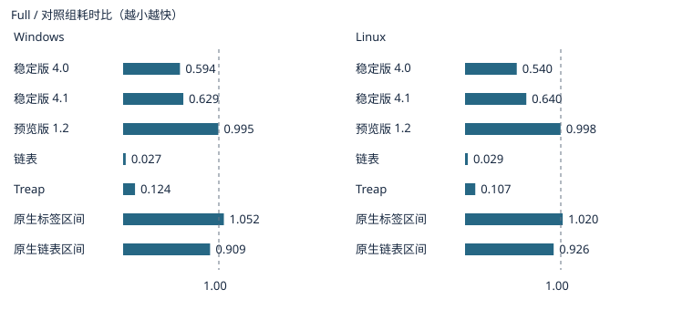
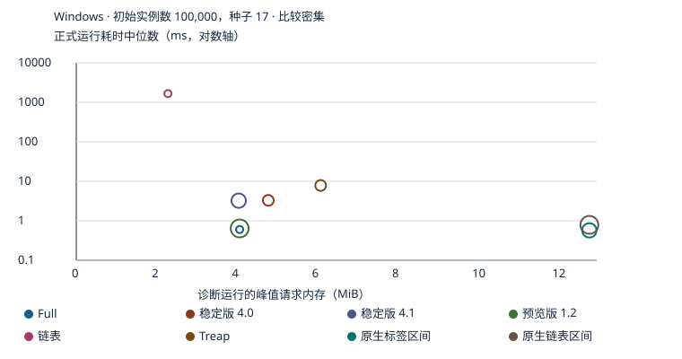

# LayerKeySort

[English](README.md) | 简体中文

已发布 Stable/Latest：[Full v4.2.0](https://github.com/RXY712200/LayerKeySort/releases/tag/v4.2.0)，发布日期 2026-11-27。[C17 源码 ZIP](https://github.com/RXY712200/LayerKeySort/releases/download/v4.2.0/LayerKeySort-4.2.0-amalgamation.zip) · [SHA-256 清单](https://github.com/RXY712200/LayerKeySort/releases/download/v4.2.0/LayerKeySort-4.2.0-SHA256SUMS.txt)。发行源码：`v4.2.0`／`f751e1ee2afd682874281d6dc495969f9eca49eb`。[历史 4.1 发行](https://github.com/RXY712200/LayerKeySort/releases/tag/v4.1.0)。

**面向动态顺序、稳定排序、批量有序处理和历史顺序的高性能 C17 库。** Full 将稳定实例 Handle、有界局部块、标签／AVL 先后查询与独立快照结合起来。各类接口可以独立使用，也可以组合。

## 按任务选择工作流

| 任务 | Full API | 提供的能力 |
| --- | --- | --- |
| 编辑器、时间线、播放列表中的相对编辑 | `LksOrder` | 插入、删除、移动、逻辑遍历及先后查询；存活 Handle 保持身份 |
| 持续维护优先级或比较器集合 | `LksManagedOrder` | 稳定等值插入、边界查询与容器内先后比较 |
| 一次性指针数组排序 | `lks_sort` | 稳定排序、复制及临时数组准备、OOM 时输入不变 |
| 排序分片及有序批次归并 | `LksGroup`、`LksGroupBatch` | 不可变指针数组副本、稳定等值优先及独立归并结果 |
| 保存历史顺序和关联数据 | `LksSnapshot` | 独立字节、可排序 LS1、LKS4SNP1 编码及新句柄恢复 |

应用拥有对象和业务身份。Full 提供顺序组件；数据库可将其与自身事务、存储、恢复组合。支持一次性排序，但有指针复制和临时存储成本。下方实时顺序比较并未测试 `qsort` 或 `std::sort`。

## 实测价值

在 Windows/Linux 配对实时顺序归档研究中，Full v4.2.0 沿用的运行实现相对 4.1 **总体耗时降低 37.1%／36.0%**，**比较密集条件降低 80.2%／78.1%**。相对两个 Stable 对照，每平台均胜出 45/45 个条件。结论适用于受测负载和具体对照。



先计算各匹配条件的 Full／对照耗时比，再取中位数；不是吞吐量百分比，也不是不相关中位数相除。每平台 45 个条件，初始 1k/10k/100k 个实例、20k 次轨迹操作，每条件／实现七次正式样本。[完整证据](https://github.com/RXY712200/LayerKeySort/blob/main/docs/FULL_RC1_EVIDENCE.zh-CN.md)保留全部七个对照及不利条件。



散点固定初始 100,000 个实例和种子 17。主耗时轴为对数，线性面板按实测坐标放大近邻点。内存是独立诊断的**峰值请求字节**（以 MiB 展示），不是进程 RAM。此比较密集条件 Full 为 4,278,776 字节，原生 OM 为 13,437,504 字节，约低 68%。图保留全部八种实现。

Full／原生标签区间 OM 总体比为 1.052/1.020；部分更新密集条件有利于原生 OM。任意相对编辑加历史的生命周期墙钟比相对受测 Treap 为 0.580/0.526（每平台五条件，Treap 逐项恢复）。端点平面历史组合更快，Full／平面为 1.137/1.136（每平台 13 条件）。Treap 批量恢复未测。实际取舍见[选型指南](https://github.com/RXY712200/LayerKeySort/blob/main/docs/FULL_SELECTION_GUIDE.zh-CN.md)。

全部时间／内存图：[Windows compare-heavy](https://raw.githubusercontent.com/RXY712200/LayerKeySort/c119c930b36becbc24392f6bb29bef761e72ea09/benchmarks/research/full-v4.2.0-rc.1/windows-compare-heavy.zh-CN.svg) · [Windows update-heavy](https://raw.githubusercontent.com/RXY712200/LayerKeySort/c119c930b36becbc24392f6bb29bef761e72ea09/benchmarks/research/full-v4.2.0-rc.1/windows-update-heavy.zh-CN.svg) · [Linux compare-heavy](https://raw.githubusercontent.com/RXY712200/LayerKeySort/c119c930b36becbc24392f6bb29bef761e72ea09/benchmarks/research/full-v4.2.0-rc.1/linux-compare-heavy.zh-CN.svg) · [Linux update-heavy](https://raw.githubusercontent.com/RXY712200/LayerKeySort/c119c930b36becbc24392f6bb29bef761e72ea09/benchmarks/research/full-v4.2.0-rc.1/linux-update-heavy.zh-CN.svg)

## 构建与首次运行

```sh
cmake -S . -B build -DLKS_BUILD_BENCHMARKS=ON
cmake --build build --config Debug --parallel
ctest --test-dir build -C Debug --output-on-failure
```

运行 `build/layerkeysort_example`（MSVC：`build/Debug/layerkeysort_example.exe`）。[basic.c](https://github.com/RXY712200/LayerKeySort/blob/f751e1ee2afd682874281d6dc495969f9eca49eb/examples/basic.c)完成创建、插入、查询、删除和销毁。[使用说明](https://github.com/RXY712200/LayerKeySort/blob/main/docs/USAGE.zh-CN.md)含稳定排序，[七个公开示例](https://github.com/RXY712200/LayerKeySort/blob/main/examples/README.zh-CN.md)覆盖托管顺序、Group 和快照恢复。

CMake ≥3.21 支持 `add_subdirectory`、离线 FetchContent 或安装后 `find_package(LayerKeySort CONFIG REQUIRED)`；链接 `LayerKeySort::layerkeysort`。只包含 `<layerkeysort.h>`。两文件分发按 C17 编译，支持 C++17 调用。见[集成命令](https://github.com/RXY712200/LayerKeySort/blob/main/docs/INTEGRATION.zh-CN.md)。

## Full 版本演进

| 版本 | 主要工程变化 | 兼容性与证据 |
| --- | --- | --- |
| 4.0 | 稳定实例 Handle、有界块／AVL、独立历史及批处理 | 冻结 64 函数／14 类型、LS1 与 LKS4SNP1；[历史发行记录](https://github.com/RXY712200/LayerKeySort/blob/main/docs/V4_STABLE.zh-CN.md) |
| 4.1 | 块共享 owner、紧凑快照元数据 | 源码兼容的存储缩减；十万至千万级历史结果及退化见[4.1 记录](https://github.com/RXY712200/LayerKeySort/blob/main/docs/V4_1_0.zh-CN.md) |
| **4.2** | 受影响槽位更新、有界标签及 AVL 回退、固定宽度线格式转换 | 公开／线格式契约不变；累计 Windows/Linux 证据及[Stable 准备记录](https://github.com/RXY712200/LayerKeySort/blob/main/docs/V4_2_0.zh-CN.md) |

已发布 Stable/Latest：[Full v4.2.0](https://github.com/RXY712200/LayerKeySort/releases/tag/v4.2.0)，发布日期 2026-11-27。[C17 源码 ZIP](https://github.com/RXY712200/LayerKeySort/releases/download/v4.2.0/LayerKeySort-4.2.0-amalgamation.zip) · [SHA-256 清单](https://github.com/RXY712200/LayerKeySort/releases/download/v4.2.0/LayerKeySort-4.2.0-SHA256SUMS.txt)。发行源码：`v4.2.0`／`f751e1ee2afd682874281d6dc495969f9eca49eb`。[历史 4.1 发行](https://github.com/RXY712200/LayerKeySort/releases/tag/v4.1.0)。

## Full 与 Mini 相互独立

| | Full | [Mini](mini/README.zh-CN.md) |
| --- | --- | --- |
| 能力 | 相对／比较器顺序、稳定排序、Group/Batch、快照及恢复 | 轻量相对编辑及稳定实例 Handle |
| 表示 | 有界块、标签及平衡索引 | 独立非侵入式双向链表 |
| 任意先后查询 | 标签路径与最坏对数 AVL 回退 | 最坏 O(n) |
| 公开 API | 64 函数 | 18 函数 |
| 构建 | 根 `CMakeLists.txt` | `mini/CMakeLists.txt` |
| 已发布版本 | [Full 4.2.0](https://github.com/RXY712200/LayerKeySort/releases/tag/v4.2.0) | [Mini 1.0.0](https://github.com/RXY712200/LayerKeySort/releases/tag/mini-v1.0.0) |

两者均不链接对方生产代码。这是能力区别，不是 Mini 性能排名。Workbench 是 `consumers/layer-order-workbench/` 下的 Mini 消费者／验证应用。Embedded/MCU 仍为未来构想。

## 契约及实际成本

Handle 表示存活实例，删除自身或销毁来源即失效，不是持久业务 ID。修改共享载荷时，须保持比较语义及全部相关有序借用结构一致。重新插入可能失败，删除／修改／重插不是事务。冲突访问需外部同步；回调守卫与来源标记原子操作不是容器锁。

局部块／索引工作受私有块策略及平衡索引维护约束，另有分配器／比较器成本。快照捕获／导出为 O(N+A)，保留历史及恢复临时数组占用内存。Full 不提供通用二进制 ABI、数据库、事务管理器或 CRDT。[完整 API 契约](https://github.com/RXY712200/LayerKeySort/blob/main/docs/IMPLEMENTATION_API_REFERENCE.zh-CN.md)与[性能证据](https://github.com/RXY712200/LayerKeySort/blob/main/docs/FULL_RC1_EVIDENCE.zh-CN.md)说明适用范围及未测替代方案。

## 文档与维护

1. [实现导读](https://github.com/RXY712200/LayerKeySort/blob/main/docs/IMPLEMENTATION_WALKTHROUGH.zh-CN.md)——16 个生产模块的执行路径。
2. [完整 API 指南](https://github.com/RXY712200/LayerKeySort/blob/main/docs/IMPLEMENTATION_API_REFERENCE.zh-CN.md)——全部 64 函数、寿命、失败及并发。
3. [内部算法](https://github.com/RXY712200/LayerKeySort/blob/main/docs/IMPLEMENTATION_INTERNALS.zh-CN.md)——有界块、标签、AVL、线格式及稳定归并。
4. [验证与分发](https://github.com/RXY712200/LayerKeySort/blob/main/docs/IMPLEMENTATION_VALIDATION.zh-CN.md)——测试、固定样例与可复现集成。

[架构](https://github.com/RXY712200/LayerKeySort/blob/main/docs/ARCHITECTURE.zh-CN.md) · [兼容性](https://github.com/RXY712200/LayerKeySort/blob/main/docs/COMPATIBILITY.zh-CN.md) · [V3 迁移](https://github.com/RXY712200/LayerKeySort/blob/main/docs/MIGRATION_V3_V4.zh-CN.md) · [开发](https://github.com/RXY712200/LayerKeySort/blob/main/docs/DEVELOPMENT.zh-CN.md) · [中文变更日志](https://github.com/RXY712200/LayerKeySort/blob/main/docs/CHANGELOG.zh-CN.md) · [原始 Changelog](https://github.com/RXY712200/LayerKeySort/blob/main/CHANGELOG.md)

[Full 路线 #3](https://github.com/RXY712200/LayerKeySort/issues/3) · [Mini 路线 #7](https://github.com/RXY712200/LayerKeySort/issues/7) · [产品线规则](docs/PRODUCT_LINES.zh-CN.md) · [贡献说明](CONTRIBUTING.md) · [MIT 许可](LICENSE) · [作者独立项目目录](https://quiveld.com/projects/independent/)
