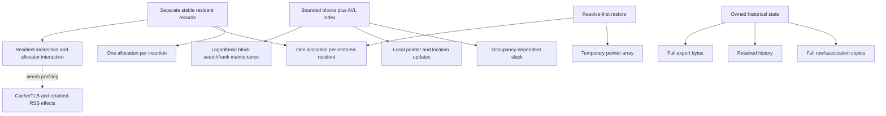

# Architecture costs, candidate directions and dependencies

This is analysis, not an implemented optimization or an approved product change.
The owner's **internal engineering-first** strategy governs prioritization.
Strong internal evidence can justify future improvement research without prior
external adoption. Genuine application traces remain useful additional evidence.

## Parent/child cost map

Separate-record allocation is a verified common parent of live insertion and
restoration allocation frequency. Block occupancy is a different parent; a pool
does not eliminate slack or local shifts. Snapshot history owns different data;
resident pooling cannot make it incremental. RSS/fragmentation/cache attribution
remains a hypothesis, not a verified common root of every slowdown.

## 1. Stable resident slabs/pools

- **Expected benefit:** fewer underlying allocations, potentially improved
  locality/metadata use during insertion, churn, restore and destruction.
- **Evidence:** large runs execute millions of resident allocations; the restore
  count is N + ceil(N/64) + 2 allocations for the measured nonempty inputs.
  One count is the resolver pointer array, one the order, then blocks/records.
  This frequency is verified; performance of a pool is not.
- **Could jointly address:** allocation turnover, some resident indirection/
  locality effects, teardown allocation bookkeeping, restoration allocation.
- **Cannot address:** callback payload locality/cost, block slack itself,
  per-block local writes, full snapshot copying, wire size, persistent identity.
- **Introduced costs:** capacity reserve, free-slot management, partially empty
  slabs, possible increased post-shrink retention and bulk release work.
- **Implementation cost:** Medium-to-large private refactor, not a simple malloc
  substitution. Per-source vs shared pools have different ownership/thread costs.
- **Stable handles:** every live record must stay at its original address;
  compacting/moving records is incompatible. Reuse after own expiry is already
  allowed, but does not authorize stale-pointer probing or persistent identity.
- **Atomicity:** prepare a usable slot/spare before mutation. Failure cannot
  publish the slot, change existing residents, or make cleanup unbounded by
  retained storage. Repeat all fault-injection/lifetime gates.
- **Snapshot/wire:** preserve detached source markers and historical lifetime;
  a marker must not live in a slab freed with the source. LS1/LKS4SNP1 remain
  unchanged. Resolver results remain borrowed caller objects.
- **Compatibility:** plausibly compatible inside frozen 4.x if all lifetime,
  ownership, callback and error semantics survive. No V5 is inherently required.
- **Priority:** High for a bounded future prototype/evaluation, not approval to
  adopt it. Compare all workloads, memory retention and cleanup, not only append.

Do not infer exact CRT metadata savings by subtracting requested bytes from
working set. Wrapper header bytes are known instrumentation overhead, not the
production allocator's overhead. A prototype must measure actual net benefit.

## 2. Resident representation alternatives

An indexed/packed store plus movable records could improve density but conflicts
with stable live pointer handles. Stable indirection records plus packed
auxiliary data could preserve addresses but add another lookup/lifetime layer.
The present public handle is opaque; it does not permit silently relocating a
live record and asking applications to reacquire it.

Evidence supports investigating storage density, not accepting any representation.
Benefits could overlap pool allocation/locality; neither removes snapshot copying
or arbitrary comparator cost. Complexity is Large if a second mapping/generation
layer is added. Atomic rollback, source ownership and teardown must remain exact.
Wire meaning can remain unchanged, but changed handle lifetime semantics would
need an explicitly justified major version. Priority **Medium**, after a smaller
stable-address storage experiment, not in parallel with disposable micro-tuning.

## 3. Occupancy/block-capacity policy

Measured occupancy histograms explain storage differences across append, random
managed insertion and evolving churn. End splitting leaves nearly half-full
blocks; fresh bulk restore packs blocks much more fully. This is not nonlinear
memory growth or a leak. Larger capacity could reduce headers/index allocations
but increases local shifts/location updates and may worsen operation tails.

The existing B64/B128/B256 screen selected B64 at 10k/100k. That finite result
does not prove optimality at 10m, and this study did not rerun capacity variants.
A new screen could be justified **after** separating resident-allocation changes
from block policy, using identical traces and frozen semantics. Priority
**Medium**, implementation Small-to-medium; address preservation and preallocated
split/repair commits are mandatory. Same source API/wire could be retained.
Do not count all requested-byte differences as allocator overhead or change B64
merely because an upper-scale table exists.

## 4. Block/index layout and search locality

Random managed insertion and broad editing deteriorate with scale much more
than endpoint/equal growth. Comparator counts, index height, location writes,
and occupancy are recorded separately. These show structural work, but do not
isolate LLC/TLB misses, branch prediction, allocator locality or payload access.
The comparator reads application items; changing Full's resident allocator
cannot automatically fix that application-data access pattern.

Cache-conscious block/index layout, B-tree-like indexing, RB trees or skip lists
are candidate hypotheses, not measured winners. They would alter pointer counts,
height, search locality, rotations/rebalancing and implementation complexity in
different directions. A fair alternative must retain moves, exact order compare,
stable residents, equality semantics, atomic failures, snapshots and cleanup.
No straw-man comparator against an array lacking those semantics is offered.

Priority **Medium** for targeted profiling, **Low** for wholesale index replacement
without that attribution. A private layout change could be compatible; a new
public rank/identity/lifetime model would require a major-version decision.

## 5. Restoration scratch and allocation

At 1m the resolver pointer array contributes 8 MB transient requested storage;
each restored resident still gets its own allocation. Pooling addresses the
larger allocation-frequency parent before optimizing this scratch symptom.

Streaming resolve/build might avoid the pointer array, but the frozen header
documents **resolve first, then unpublished bulk construction**. Interleaving
fallible structure allocation with callbacks can change which callbacks execute
before OOM, their side effects, and documented sequencing. It is not automatically
a compatible small optimization just because output stays NULL on failure.
Resolver-created objects remain caller-owned, including failure cases.

Priority **Medium** for allocation reduction through compatible storage, **Low**
for scratch elimination until profiling/budgets justify it and compatibility is
reviewed. Do not add shared mutable scratch to snapshots that currently support
immutable reads with externally protected lifetime.

## 6. Snapshot storage and retention

The measured captures own 16N row bytes plus geometrically grown association
capacity. Wire uses 16N+40 bytes for these 8-byte associations/16-byte namespaces.
Neither ownership nor O(N+A) export is an accidental continuation of V3 relabel.

Right-sizing association capacity could save slack near capacity boundaries,
but an extra shrink/copy/realloc has cost and failure implications. Calling the
association callback twice to pre-count is not an equivalent implementation:
returned spans only remain valid through immediate copy, callbacks may have side
effects, and the documented call contract must survive. Two-pass assumptions
cannot be invented. Compression/deduplication/shared history adds refcount,
ownership, concurrency and failure-atomicity complexity.

Priority **Medium** for explicit snapshot-cost work if internal memory targets
justify it; no external adoption prerequisite. Start with measured in-memory
capacity and callback/copy cost, then compare full cost including teardown.
Incremental historical representations are a larger design, not automatically
necessary. LS1/LKS4SNP1 meaning must remain frozen; incompatible external bytes
need a new format family/version. None of these changes fixes live allocation.

## Historical alternatives retained

- V3 tail-cost policies (direct7/direct8/depth_bias/equal8/open_range/open_dense)
  traded rare full relabels for recurring work/storage in the old Path model.
  They are superseded by V4 contextual live order, not candidates to transplant.
- Theory-guided reserve strategies had their own recurring traffic/storage
  tradeoffs; no universal impossibility theorem followed.
- Pre-V4 I/S prototypes explored contextual block versus per-item indexing;
  fewer structural writes in one strategy came with larger resident metadata.
  Those unfinished prototype lifetimes are not equivalent production contracts.
- The F mixed-epoch key attempt had an actual ordering counterexample; budgets
  1/8/32/128 failed that implementation. This does not refute every possible
  independent-key theory, nor justify reviving it in a local storage optimization.
- B64 was selected over B128/B256 in a finite earlier screen. Preserve that
  evidence; a new upper-scale screen must record the new tradeoff, not rewrite it.

References: current `docs/design/V4_DECISIONS.md`, `docs/design/V4_ARCHITECTURE.md`,
`benchmarks/results/v4-preview4/README.md`, and the exact previous consumer commit
`bf27502f18de5988cd2d1c797ddc3e0ff48d0b03`.

## Recommended work order

1. Independently review the research/oracles, raw measurements and attribution.
2. Prototype stable-address resident allocation/storage in an isolated future
   experiment; jointly test live insertion/churn/restore/destruction and retained
   memory. Preserve failure atomicity before making any adoption decision.
3. Profile large random managed insertion and broad moves to separate structural
   work from allocator, payload, cache/TLB and OS costs. Use counters/profiling
   when available; current causal attribution is incomplete.
4. Reassess block/index layout or capacity after understanding those parents.
   Avoid tuning child write loops that a storage/layout change would replace.
5. Pursue snapshot-capacity/copy and restore-scratch work as separate branches
   when their measured cost is the target; do not conflate retained history with
   a live-record leak. Review callback sequencing before scratch elimination.
6. Adopt only after complete semantic/OOM/compatibility and multi-workload
   validation. No current evidence requires breaking 4.x or implementing V5.

This order is an engineering proposal. No improvement is approved or implemented
by this research assignment, and no acceptance decision is made here.
