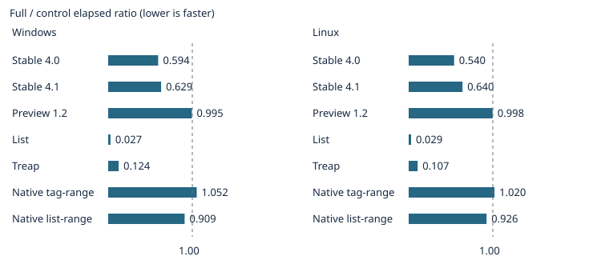
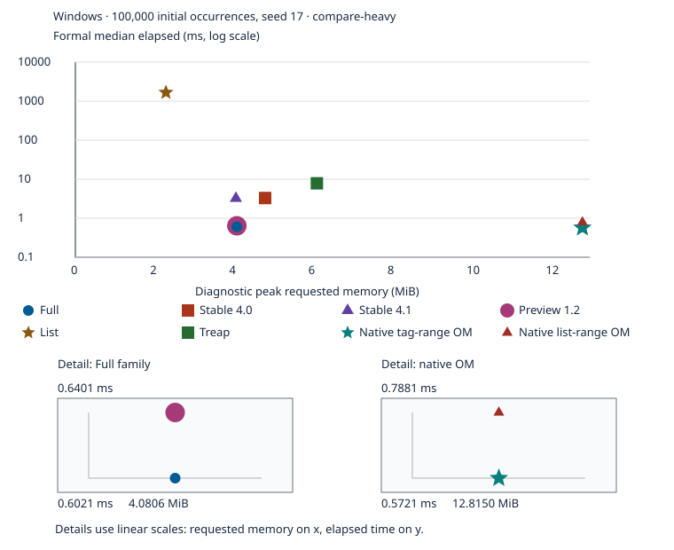
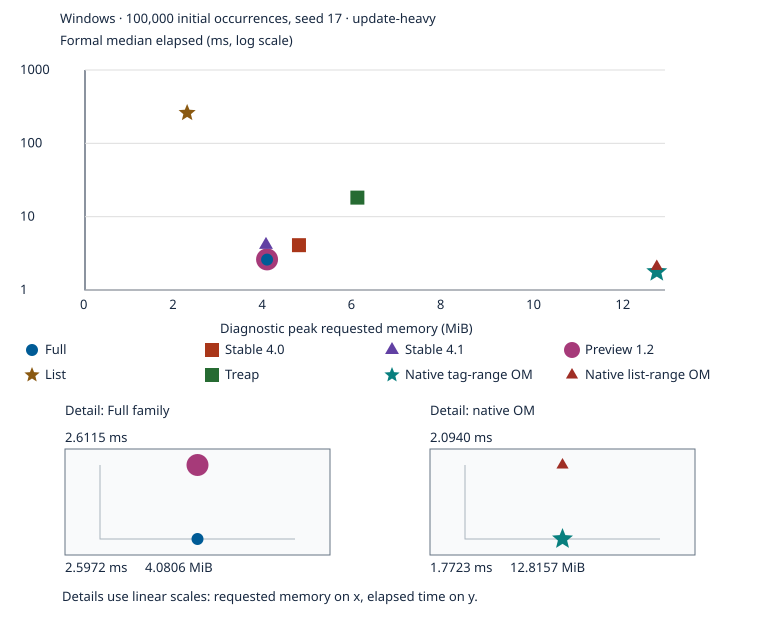
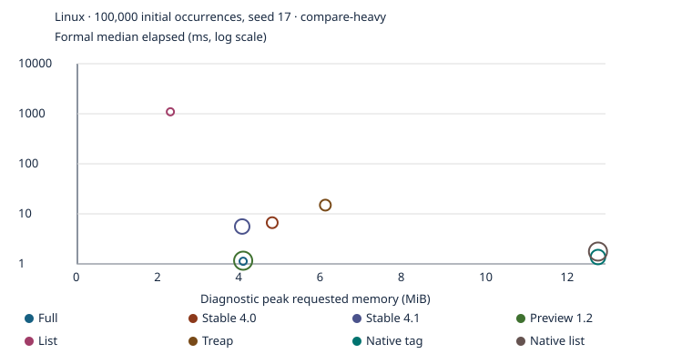
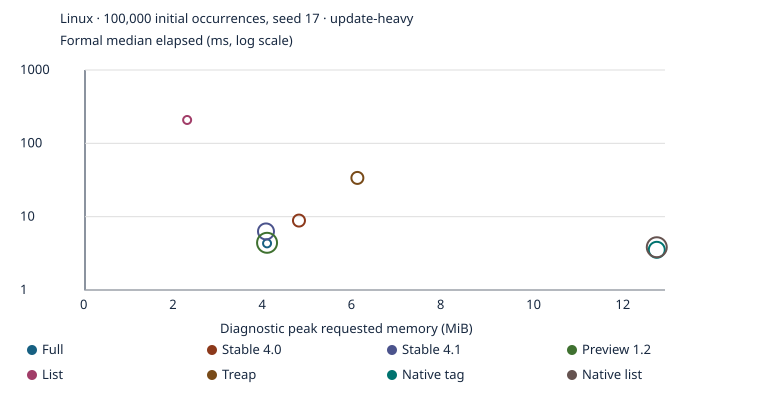

# LayerKeySort Full — v4.2.0 Stable

English | [简体中文](FULL.zh-CN.md)

**High-performance C17 libraries for dynamic ordering, stable sorting, batch ordered processing and historical ordering.** Full combines stable occurrence Handles, bounded local blocks and label/AVL precedence with independently owned snapshots. Choose one API family or combine them.

## Choose the workflow

| Your job | Full API | What it provides |
| --- | --- | --- |
| Edit relative positions in an editor, timeline or playlist | `LksOrder` | Insert, remove, move, logical traversal and precedence; surviving Handles retain identity |
| Maintain priorities or comparator-based collections | `LksManagedOrder` | Stable equal insertion, bound lookup and contextual comparison |
| Sort a pointer array once | `lks_sort` | Stable ordering, copied/scratch preparation, input unchanged on OOM |
| Sort chunks and merge ordered batches | `LksGroup`, `LksGroupBatch` | Immutable copied pointer arrays, stable equality precedence and fresh merge results |
| Save historical order and associations | `LksSnapshot` | Independent bytes, sortable LS1 keys, LKS4SNP1 encoding and fresh-handle restoration |

Applications own payloads and business identities. Full supplies ordering components; a database can use them alongside its own transactions, storage and recovery. One-shot sorting is supported, with pointer-copy and scratch costs. The live-order comparisons below do not benchmark `qsort` or `std::sort`.

## Measured value

In the archived Windows/Linux matched live-order study, Full v4.2.0's unchanged operational implementation used **37.1% / 36.0% less elapsed time than 4.1 overall**, and **80.2% / 78.1% less in compare-heavy cells**. It won 45/45 cells per host against both Stable controls. Results depend on the tested workload and control.



Ratios are Full/control elapsed time: the median of paired cell ratios, not throughput percentage or a ratio of unrelated medians. Each host has 45 matched cells, 1k/10k/100k initial occurrences, 20k trace operations and seven formal samples per cell/implementation. All seven controls and adverse conditions are retained in [the full evidence](https://github.com/RXY712200/LayerKeySort/blob/c119c930b36becbc24392f6bb29bef761e72ea09/docs/FULL_RC1_EVIDENCE.md).



The scatter fixes 100,000 initial occurrences and seed 17. Main elapsed axis is logarithmic; linear panels show near-coincident points at their measured coordinates. Memory is separately measured diagnostic **peak requested bytes**, shown in MiB, rather than process RAM. In this compare-heavy example Full requested 4,278,776 bytes versus native OM 13,437,504 bytes, about 68% lower. The graph retains all eight variants.

Full/native tag-range OM overall ratios were 1.052/1.020; some update-heavy conditions favor native OM. For arbitrary relative editing with history, Full/tested Treap lifecycle wall-time ratios were 0.580/0.526 (five cells/host, incremental Treap restore). Endpoint flat history was faster: Full/flat 1.137/1.136 (13 cells/host). Bulk Treap restore is unmeasured. See [selection guidance](https://github.com/RXY712200/LayerKeySort/blob/c119c930b36becbc24392f6bb29bef761e72ea09/docs/FULL_SELECTION_GUIDE.md) for practical tradeoffs.

## Complete time/memory comparison








Each plot uses the same initial size, seed, units and linear-detail rules. Open the SVG for full-size inspection; exact coordinates, accounting and raw hashes are in the evidence linked above.

## Build and first use

```sh
cmake -S . -B build -DLKS_BUILD_BENCHMARKS=ON
cmake --build build --config Debug --parallel
ctest --test-dir build -C Debug --output-on-failure
```

Run `build/layerkeysort_example` (MSVC: `build/Debug/layerkeysort_example.exe`). [basic.c](https://github.com/RXY712200/LayerKeySort/blob/c119c930b36becbc24392f6bb29bef761e72ea09/examples/basic.c) creates a container, inserts, queries, removes and destroys it. [Usage](https://github.com/RXY712200/LayerKeySort/blob/c119c930b36becbc24392f6bb29bef761e72ea09/docs/USAGE.md) includes stable sorting; [seven public examples](https://github.com/RXY712200/LayerKeySort/blob/c119c930b36becbc24392f6bb29bef761e72ea09/examples/README.md) cover managed order, Groups and snapshot restore.

CMake ≥3.21: `add_subdirectory`, offline FetchContent or installed `find_package(LayerKeySort CONFIG REQUIRED)`; link `LayerKeySort::layerkeysort`. Include only `<layerkeysort.h>`. The two-file distribution compiles as C17 and supports C++17 callers. [Integration commands](https://github.com/RXY712200/LayerKeySort/blob/c119c930b36becbc24392f6bb29bef761e72ea09/docs/INTEGRATION.md).

## Full version evolution

| Edition | Main engineering change | Compatibility and evidence |
| --- | --- | --- |
| 4.0 | Stable occurrence Handles, bounded blocks/AVL, immutable history and batch utilities | Frozen 64 functions / 14 types, LS1 and LKS4SNP1; [historical release record](https://github.com/RXY712200/LayerKeySort/blob/c119c930b36becbc24392f6bb29bef761e72ea09/docs/V4_STABLE.md) |
| 4.1 | Shared Block owner and compact Snapshot metadata | Source-compatible storage reduction; historical 100k–10m results and regressions in [4.1 record](https://github.com/RXY712200/LayerKeySort/blob/c119c930b36becbc24392f6bb29bef761e72ea09/docs/V4_1_0.md) |
| **4.2** | Affected-slot updates, bounded labels with AVL fallback, fixed-width wire conversion | Same public/wire contracts; cumulative Windows/Linux evidence and [Stable preparation record](https://github.com/RXY712200/LayerKeySort/blob/c119c930b36becbc24392f6bb29bef761e72ea09/docs/V4_2_0.md) |

**Download/source status:** This documentation presents the prepared Full v4.2.0 Stable edition at an immutable preparation revision. Main remains the integrated 4.2.0-rc.1 source until authorized integration. Published Stable and repository Latest remain [v4.1.0](https://github.com/RXY712200/LayerKeySort/releases/tag/v4.1.0); use that working release for published assets. The planned v4.2.0 tag and assets have not been published. [Stable 4.1 API](https://github.com/RXY712200/LayerKeySort/blob/70d7f0ef5857b54381b863d292a213909d87459f/docs/API.md) remains accessible.

## Full and Mini are independent

| | Full | [Mini](../mini/README.md) |
| --- | --- | --- |
| Capabilities | Relative and comparator order, stable sort, Group/Batch, snapshots and restore | Lightweight relative edits and stable occurrence Handles |
| Representation | Bounded blocks, labels and balanced index | Independent non-intrusive doubly linked list |
| Arbitrary precedence | Label path with logarithmic AVL fallback | O(n) worst case |
| Public API | 64 functions | 18 functions |
| Build | Root `CMakeLists.txt` | `mini/CMakeLists.txt` |
| Published release | [Full 4.1.0](https://github.com/RXY712200/LayerKeySort/releases/tag/v4.1.0) | [Mini 1.0.0](https://github.com/RXY712200/LayerKeySort/releases/tag/mini-v1.0.0) |

Neither product links the other's production code. These are capability distinctions, not Mini performance rankings. Workbench is a Mini consumer/validation application under `consumers/layer-order-workbench/`. Embedded/MCU remains a future concept.

## Contracts and practical costs

Handles represent live occurrences and expire on own removal/source destruction; they are not durable application IDs. Keep comparator semantics and all affected sorted borrowers consistent when editing shared payloads. Reinsertion can fail and remove/edit/reinsert is not transactional. Caller synchronization is required for conflicting access; callback guards and marker atomics are not container locks.

Local block/index work is bounded by private block policy plus balanced-index maintenance, with allocator/comparator costs in addition. Snapshot capture/export is O(N+A); retained histories and restore scratch consume memory. Full supplies no general binary ABI, database, transaction manager or CRDT. The [complete API contracts](https://github.com/RXY712200/LayerKeySort/blob/c119c930b36becbc24392f6bb29bef761e72ea09/docs/IMPLEMENTATION_API_REFERENCE.md) and [performance evidence](https://github.com/RXY712200/LayerKeySort/blob/c119c930b36becbc24392f6bb29bef761e72ea09/docs/FULL_RC1_EVIDENCE.md) describe applicability and unmeasured alternatives.

## Documentation and maintenance

1. [Implementation walkthrough](https://github.com/RXY712200/LayerKeySort/blob/c119c930b36becbc24392f6bb29bef761e72ea09/docs/IMPLEMENTATION_WALKTHROUGH.md) — execution paths across 16 production modules.
2. [Complete API guide](https://github.com/RXY712200/LayerKeySort/blob/c119c930b36becbc24392f6bb29bef761e72ea09/docs/IMPLEMENTATION_API_REFERENCE.md) — all 64 functions, lifetime, failure and concurrency.
3. [Internal algorithms](https://github.com/RXY712200/LayerKeySort/blob/c119c930b36becbc24392f6bb29bef761e72ea09/docs/IMPLEMENTATION_INTERNALS.md) — bounded blocks, labels, AVL, wire and stable merging.
4. [Validation and distribution](https://github.com/RXY712200/LayerKeySort/blob/c119c930b36becbc24392f6bb29bef761e72ea09/docs/IMPLEMENTATION_VALIDATION.md) — tests, fixtures and reproducible integration.

[Architecture](https://github.com/RXY712200/LayerKeySort/blob/c119c930b36becbc24392f6bb29bef761e72ea09/docs/ARCHITECTURE.md) · [Compatibility](https://github.com/RXY712200/LayerKeySort/blob/c119c930b36becbc24392f6bb29bef761e72ea09/docs/COMPATIBILITY.md) · [V3 migration](https://github.com/RXY712200/LayerKeySort/blob/c119c930b36becbc24392f6bb29bef761e72ea09/docs/MIGRATION_V3_V4.md) · [Development](https://github.com/RXY712200/LayerKeySort/blob/c119c930b36becbc24392f6bb29bef761e72ea09/docs/DEVELOPMENT.md) · [Changelog](https://github.com/RXY712200/LayerKeySort/blob/c119c930b36becbc24392f6bb29bef761e72ea09/CHANGELOG.md)

[Full roadmap #3](https://github.com/RXY712200/LayerKeySort/issues/3) · [Mini roadmap #7](https://github.com/RXY712200/LayerKeySort/issues/7) · [Product-line policy](PRODUCT_LINES.md) · [Contributing](../CONTRIBUTING.md) · [MIT license](../LICENSE) · [Author’s independent project directory](https://quiveld.com/projects/independent/)

Integration navigation handoff: the two Repo-owned Full entries in `docs/index.html` select this preparation branch for review. After separately authorized integration, change them to `blob/main/docs/FULL.md` and `blob/main/docs/FULL.zh-CN.md`. Current Full technical documents and figures remain pinned to the immutable Full preparation revision; retain v4.1.0 download access until publication.
