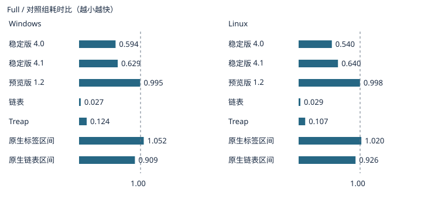

# LayerKeySort Full — v4.1.0 Stable

## Full：Stable 与候选版

主分支和已发布 Stable 均为 **4.1.0**。需要可下载的源码或发行包时，请使用 [Stable 发行页](https://github.com/RXY712200/LayerKeySort/releases/tag/v4.1.0)。独立的 4.2 候选分支仍在审查，尚未合并、打标签或发布。Mini 使用独立的版本和发布路径。

Full 用稳定 Handle 表示实时顺序中的单次存活实例；应用持有业务对象、身份和事务。4.2 候选版在跨块比较中优先使用有界标签，必要时回退到 AVL。以下是 [固定候选证据](https://github.com/RXY712200/LayerKeySort/blob/c4ef94497cd7d7c653b09dba0aa58eb27c70f0be/docs/FULL_RC1_EVIDENCE.zh-CN.md) 中相对 Stable 4.1 的配对耗时比与耗时降幅：

| 负载 | Windows | Linux |
| --- | ---: | ---: |
| 全部实时顺序条件 | 0.629（降低 37.1%） | 0.640（降低 36.0%） |
| 比较密集条件 | 0.198（降低 80.2%） | 0.219（降低 78.1%） |

比值为候选耗时除以对照耗时。先分别计算同一平台每个匹配条件的耗时比，再取这些比值的中位数。初始规模为 1k、10k 和 100k 个实例。端点编辑和平面历史的生命周期对照中，平面组合更快。需要相对编辑与历史恢复时，先按目标负载比较。参见 [候选验证](https://github.com/RXY712200/LayerKeySort/blob/c4ef94497cd7d7c653b09dba0aa58eb27c70f0be/docs/V4_2_0_RC1.zh-CN.md) 与 [候选实现导读](https://github.com/RXY712200/LayerKeySort/blob/c4ef94497cd7d7c653b09dba0aa58eb27c70f0be/docs/IMPLEMENTATION_WALKTHROUGH.zh-CN.md)。另见[历史 V4 架构设计的完整中文译本](https://github.com/RXY712200/LayerKeySort/blob/c4ef94497cd7d7c653b09dba0aa58eb27c70f0be/docs/design/V4_ARCHITECTURE.zh-CN.md)。下文仓库内链接描述主分支的 Stable 基线。




[← LayerKeySort 产品家族首页](../README.zh-CN.md) | [English](FULL.md) | 简体中文

本页专门介绍仓库根目录的 **Full** 产品，而不是 Mini。公共 API、持久化格式与兼容性契约以 [V4_FREEZE](V4_FREEZE.md) 等权威文档为准。

LayerKeySort 是一个 **C17 动态顺序管理库**。它解决的不是“把一组元素一次排好”，
而是“一个集合长期存在，并且持续发生插入、删除、移动、遍历、保存历史顺序和恢复”。

**实时顺序使用稳定的容器内句柄；历史/持久化顺序使用不可变快照和 LS1 键。**

**[LayerKeySort Full v4.1.0](https://github.com/RXY712200/LayerKeySort/releases/tag/v4.1.0) 是当前已发布的 Stable 版本。**
该 Release 提供与注解源码标签对应、经过校验的 amalgamation ZIP 和 SHA-256 清单。
[4.1.0 更新记录](V4_1_0.md)说明了内存优化与已测出的部分性能回退。
V4 的 Preview.1–5 → RC.1 → v4.0.0 Stable 历史开发周期仍然保留。
V3.1.0 仍作为历史 Stable 保留给依赖 Path/Tree 契约的应用；V4 是源码级大版本变化，
不是可以直接替换头文件的兼容升级。

当前 post-v4 roadmap 与技术债统一记录在
[Issue #3](https://github.com/RXY712200/LayerKeySort/issues/3)。
历史 Issue #2 已关闭但完整保留。

## 它适合什么？

LayerKeySort 最适合长期维护复杂本地 mutable collection 的软件，例如：

- 图层编辑器；
- 视频 / 音频时间线；
- CAD、游戏编辑器；
- 节点 / 工作流编辑器；
- 播放列表编辑器；
- 本地文档编辑系统；
- 大型 UI / 树结构中的某一层扁平顺序。

典型操作不是“排序一次”，而是：

```text
把 A 插到 B 前面
把 C 移到 D 后面
删除 E
加入 F
读取第一个 / 下一个
捕获当前历史顺序
保存后恢复并继续编辑
```

如果你只需要一次性排序、简单 SQL `position` 字段、CRDT/分布式协同顺序，
或者跨进程长期业务 ID，LayerKeySort 通常不是最合适的工具。

## 四个主要入口

- `LksOrder`：显式相对顺序，支持前/后插入、移动、遍历和稳定 resident handle。
- `LksManagedOrder`：由比较器维护顺序，保证相等元素的稳定插入语义。
- `LksGroup` / `LksGroupBatch`：不可变平面序列、稳定构建和合并。
- `LksSnapshot`：历史快照、LS1、LKS4SNP1、序列化和恢复。

业务对象与业务 ID 始终由应用拥有。

**Handle 不是持久化 ID。LS1 也不是 live position。**

## 最小示例

```sh
cmake -S . -B build -DLKS_BUILD_BENCHMARKS=ON
cmake --build build --config Debug --parallel
ctest --test-dir build -C Debug --output-on-failure
```

构建后运行 `build/layerkeysort_example`。使用 MSVC 时运行 `build/Debug/layerkeysort_example.exe`。 [最小示例源码](../examples/basic.c)

```c
#include <layerkeysort.h>

int main(void) {
    int item = 42;
    const LksOrderHandle *handle = NULL;
    LksOrder *order = lks_order_create();
    if (!order) return 1;

    if (lks_order_insert_back(order, &item, &handle) != LKS_STATUS_OK) {
        lks_order_destroy(order);
        return 2;
    }

    lks_order_destroy(order); /* item 仍由应用拥有 */
    return 0;
}
```

完整公开示例见 [examples/README.md](../examples/README.md)。

## 集成

支持 CMake `add_subdirectory`、离线 FetchContent、本地安装 +
`find_package(LayerKeySort CONFIG REQUIRED)`。CMake 最低版本为 3.21，链接目标为 `LayerKeySort::layerkeysort`。普通使用者无需 Python 或私有头文件。发布提供可重复生成的两文件 C17 源码 ZIP 和 SHA256SUMS，C++17 应用可链接 C 库。

见：

- [中文集成指南](INTEGRATION.zh-CN.md)
- [英文完整集成指南](INTEGRATION.md)
- [API 参考](API.md)
- [使用指南](USAGE.zh-CN.md)
- [V3 → V4 迁移](MIGRATION_V3_V4.md)

## 已知成本与边界

V4 不再为 live resident 维护 Path/LK1，因此避免了 V3 的全范围 live-coordinate relabel
和 live Path 增长；但它仍然有真实成本：

- 每 resident allocation；
- block slack 和局部指针移动；
- comparator / callback / allocator / OS 成本；
- 完整 snapshot/export 是显式 `O(N+A)`；
- 保留大量历史 snapshot 会占用相应历史内存。

调用者须串行访问可变来源，维持应用对象和比较器上下文的生命周期及排序语义。移除后不得用悬空句柄查询其有效性。不承诺所有操作的统一硬延迟上界，
也不承诺 universal binary ABI、CRDT、持久化 live handle 或数据库职责。

较新的 [4.1.0 更新记录](V4_1_0.md)包含 10 万至千万级研究、
内存收益和真实的性能回退；不保证所有负载都更快。早期的
[Preview.4 evidence](../benchmarks/results/v4-preview4/README.md) 和
[v4.0.0 Stable 历史记录](V4_STABLE.md)仍然完整保留。

## 长期方向

LayerKeySort 的长期定位是 **dynamic ordering library**，而不是传统 sorting library。
核心边界保持在：

1. Mutable Order Engine；
2. Immutable Historical Representation；
3. Immutable Batch Utilities。

不为了版本号仓促启动 V5，也不设立必须尽快推广的时间表。
未来以明确的正确性、性能、内存或兼容性问题驱动内部工程研究；
真实编辑器数据有价值，但不是继续开发的前提。

Mini 已在独立的 `mini/` 目录发布 v1.0.0 Stable，但不属于 Full V4 的 API 契约；Embedded 等其他产品线仍只是未来设想，不代表已经实现。
详见 [Issue #3](https://github.com/RXY712200/LayerKeySort/issues/3)。

## 文档

- [架构](ARCHITECTURE.md)
- [API](API.md)
- [兼容性](COMPATIBILITY.md)
- [验证](VALIDATION.md)
- [开发维护](DEVELOPMENT.md)
- [4.1.0 更新记录](V4_1_0.md)
- [v4.0.0 Stable 历史记录](V4_STABLE.md)
- [Changelog](../CHANGELOG.md)

License: [MIT](../LICENSE)。
