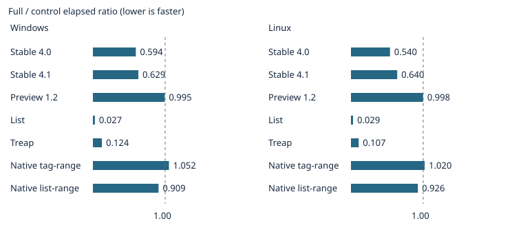
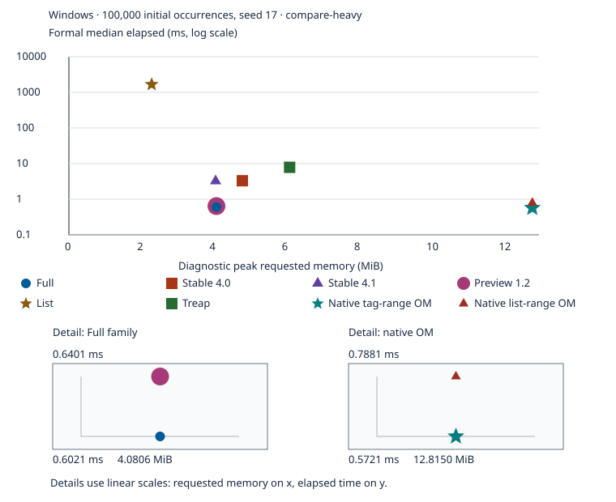
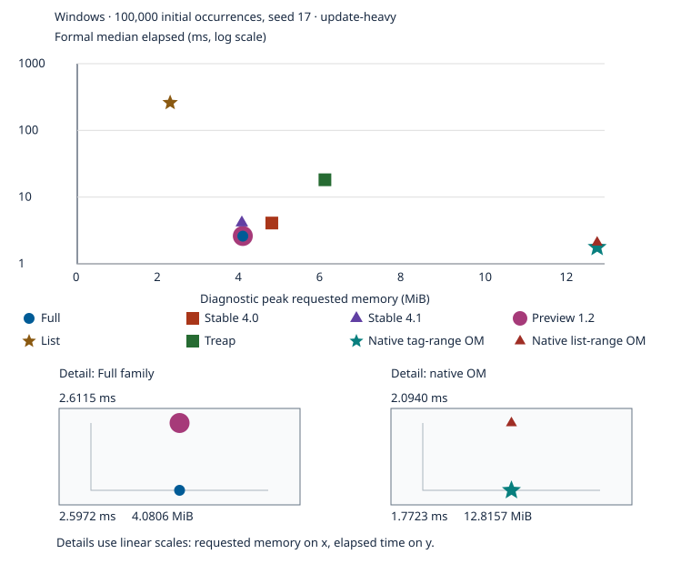
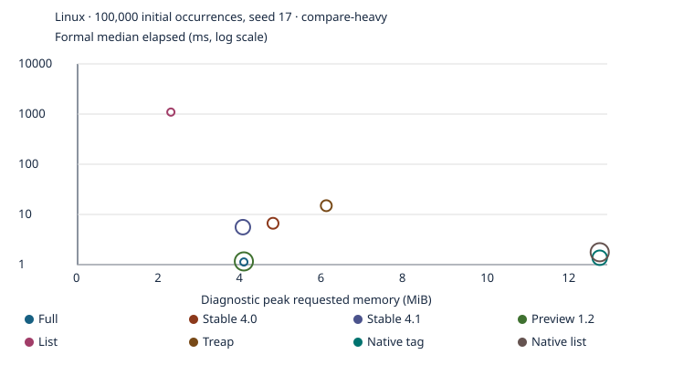
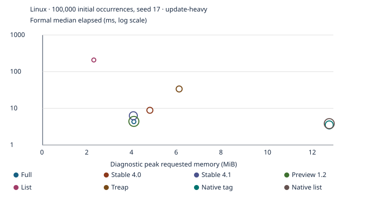

# Full 4.2.0 RC evidence

[简体中文](FULL_RC1_EVIDENCE.zh-CN.md)

Published Stable and main are 4.1.0. The untagged RC inherits operational source `fe00536e7bd7f4e5128432ea4a29e54158074903`. These are archived runs of that implementation and its controls.

## Evolution and comparability

| Checkpoint | Change and reference | Measurement and resources |
| --- | --- | --- |
| Stable 4.0 → 4.1 | Block-owned owner pointer, compact snapshot rows. [4.1.0](V4_1_0.md) | Measured x64 Resident 32 → 24 bytes and row metadata 16 → 8 bytes. Workload timings in the release study are separate. |
| Preview.1 | Affected-range updates and ancestry comparison at 22544cf2. [Evidence](V4_2_0_PREVIEW1.md) | Hosted Windows/Linux versus 4.1.0: 0.69786/0.70889 overall (30.2%/29.1% lower), 0.57230/0.56894 compare-heavy. Versus 4.0.0: 0.62587/0.66618 overall. The separate local Windows run versus 4.1.0 was 0.72003 overall and 0.54343 compare-heavy. Seven local profiles had equal peak requested bytes. |
| Preview.1.2 | Bounded labels at 61e9290e. [Evidence](V4_2_0_PREVIEW1_2.md) | Separate comparison versus Preview.1: 10.2%/11.4% reduction Windows/Linux, peak requested bytes at most +0.600%. |
| Preview.1.2.1 | Diagnostic monotonicity at c977b0fd. [History](design/V4_2_0_LIVE_CORE_RESEARCH_HISTORY.md) | B32, B128, direct transfer and midpoint-only labels rejected. The diagnostic update changes no production timing path. |
| Preview.2 | Fixed-width wire conversion at fe00536e. [Evidence](V4_2_0_PREVIEW2.md) | Selected decode median reduction 32.9%/50.6% Windows/Linux, equal requested memory in that comparison. |
| Preview.3 / RC.1 | Offset-one and restored-tag tests at 754b3088 / 3ac82d26. [Evidence](V4_2_0_PREVIEW3.md) | Current production benchmark below. RC metadata/verification introduce no further measured gain. |

## Contemporaneous live comparison

Ratios are candidate/control, percentage reduction is (1 − ratio) × 100, and speedup is 1/ratio. Each row reports median ratio across all cells, median across compare-heavy cells, and all-cell wins. Relative to Stable 4.1, the candidate reduces the median matched-cell elapsed ratio by 37.1% on Windows and 36.0% on Linux.

| Control | Windows overall / compare-heavy / wins | Linux overall / compare-heavy / wins |
| --- | --- | --- |
| Stable 4.0 | 0.593973 / 0.191293 / 45/45 | 0.540286 / 0.192341 / 45/45 |
| Stable 4.1 | 0.629106 / 0.197718 / 45/45 | 0.640047 / 0.219173 / 45/45 |
| Preview.1.2 | 0.994524 / 0.996669 / 29/45 | 0.998139 / 1.002047 / 24/45 |
| List | 0.027376 / 0.002536 / 45/45 | 0.028692 / 0.002982 / 43/45 |
| Threaded Treap | 0.124475 / 0.074047 / 45/45 | 0.106949 / 0.071966 / 45/45 |
| Native tag-range | 1.052438 / 0.907887 / 21/45 | 1.020154 / 0.907199 / 22/45 |
| Native list-range | 0.908532 / 0.623951 / 25/45 | 0.925724 / 0.681448 / 28/45 |

The logarithmic elapsed axis shows all eight measured variants. Filled markers retain the measured positions. Larger markers are drawn first. Linear detail panels show near-coincident Full and native OM points at their original coordinates. The numeric table below provides exact coordinates. Each scatter panel fixes seed 17 and 100,000 initial occurrences. Clock time is the median of seven formal processes. Memory comes from the separate matched diagnostic process. For compare-heavy, Full uses 4,278,776 peak requested bytes versus 13,437,504 for native OM under their respective allocator accounting. Requested peak excludes untracked external allocations and differs from retained bytes, allocation traffic, wire bytes and process working set. Native OM can win on update-heavy traces. The worst Windows short trace against Preview.1.2 was 1.424; a paired repeat yielded 0.996. Both results remain in the archive.

Run `python benchmarks/research/full-v4.2.0-rc.1/generate.py` from the root. [Derived values, raw hashes and adverse cells](../benchmarks/research/full-v4.2.0-rc.1/live-derived.json) use the [Windows](../benchmarks/research/full-v4.2.0-rc.1/../full-v4.2.0-preview.3/final-matrix/Windows/metadata.json) and [Linux](../benchmarks/research/full-v4.2.0-rc.1/../full-v4.2.0-preview.3/final-matrix/Linux/metadata.json) manifests for source, compiler, host and binary identity. Group by size, seed, scenario and trace hash. The 20,000-operation traces use separate warmup, seven formal samples, and allocation diagnostics. [Protocol](../benchmarks/research/full-v4.2.0-rc.1/../full-v4.2.0-preview.3/PROTOCOL.md) and [raw archive](../benchmarks/research/full-v4.2.0-rc.1/../full-v4.2.0-preview.3/final-matrix).

## Scatter coordinates

| Host | Workload | Implementation | Peak requested bytes | Median elapsed (ms) |
| --- | --- | --- | ---: | ---: |
| Windows | compare-heavy | full | 4278776 | 0.602100 |
| Windows | compare-heavy | stable40 | 5028760 | 3.293100 |
| Windows | compare-heavy | stable41 | 4253752 | 3.232300 |
| Windows | compare-heavy | preview1 | 4278776 | 0.640100 |
| Windows | compare-heavy | list | 2400168 | 1664.274300 |
| Windows | compare-heavy | tree | 6400424 | 7.846000 |
| Windows | compare-heavy | tag | 13437504 | 0.572100 |
| Windows | compare-heavy | list_range | 13437504 | 0.788100 |
| Windows | update-heavy | full | 4278800 | 2.597200 |
| Windows | update-heavy | stable40 | 5028792 | 4.084900 |
| Windows | update-heavy | stable41 | 4253776 | 4.128400 |
| Windows | update-heavy | preview1 | 4278800 | 2.611500 |
| Windows | update-heavy | list | 2400576 | 259.831300 |
| Windows | update-heavy | tree | 6401512 | 18.185700 |
| Windows | update-heavy | tag | 13438184 | 1.772300 |
| Windows | update-heavy | list_range | 13438184 | 2.094000 |
| Linux | compare-heavy | full | 4278776 | 1.127721 |
| Linux | compare-heavy | stable40 | 5028760 | 6.663075 |
| Linux | compare-heavy | stable41 | 4253752 | 5.580504 |
| Linux | compare-heavy | preview1 | 4278776 | 1.158808 |
| Linux | compare-heavy | list | 2400168 | 1094.379312 |
| Linux | compare-heavy | tree | 6400424 | 14.941655 |
| Linux | compare-heavy | tag | 13437504 | 1.370782 |
| Linux | compare-heavy | list_range | 13437504 | 1.763961 |
| Linux | update-heavy | full | 4278800 | 4.322430 |
| Linux | update-heavy | stable40 | 5028792 | 8.847155 |
| Linux | update-heavy | stable41 | 4253776 | 6.288885 |
| Linux | update-heavy | preview1 | 4278800 | 4.402037 |
| Linux | update-heavy | list | 2400576 | 208.157465 |
| Linux | update-heavy | tree | 6401512 | 33.748477 |
| Linux | update-heavy | tag | 13438184 | 3.532692 |
| Linux | update-heavy | list_range | 13438184 | 3.829643 |

## Lifecycle, native application and scale

| Comparison | Windows | Linux | Scope |
| --- | ---: | ---: | --- |
| Final / flat | 1.137284 | 1.136323 | 13 endpoint cells per host. |
| Final / threaded Treap | 0.580369 | 0.526053 | 5 arbitrary-relative cells per host. |

These are process-wall measurements. Summed phases are separate. Test states include 1k–100k occurrences, retention 0/1/2/8/16, empty through 4096-byte associations and 8/4096-byte namespaces. Independent holdouts test additional states and mutation rates. The tested Treap restores incrementally; bulk restore is unmeasured. Callback, failure and provenance guarantees differ. See [analysis reproduction](../benchmarks/research/full-v4.2.0-rc.1/../full-v4.2.0-preview.3/REPRODUCTION.md).

OrdWeave supplied 702 observations across 27 generated traces in both memory and persistent modes, including warmups and profiles. Final/Preview.1.2 operation latency ratios were 1.001530 and 0.997323. Staging/publication occupied 94.5% in memory; WAL occupied 96.6% in persistence, including nested flush. These generated application workloads are distinct from field telemetry. The official dependency remains 4.1.0. [Native archive](https://github.com/RXY712200/OrdWeave/tree/ebfa5c62245f793e90fde590b577003839d3e0b1/benchmarks/research/full-preview3-20261125).

The guarded sparse histories tested 10k/100k/1m. At 1m, shrink to 10,000 surviving Handles reduced requested live bytes from 42,753,776 to 431,576. Clustered and scattered survivors retained identity across two cycles. Multi-million states, long retention and unbounded tag recovery remain unmeasured. [Scale evidence](V4_2_0_PREVIEW2.md#step-5-resource-envelope-and-live-guard) · [Selection guide](FULL_SELECTION_GUIDE.md).
