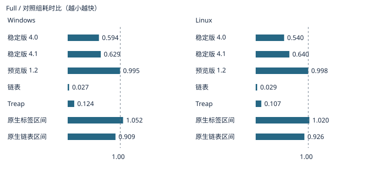
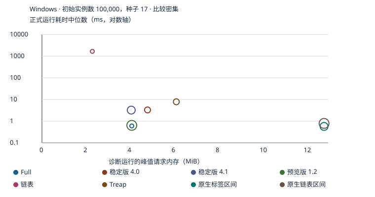
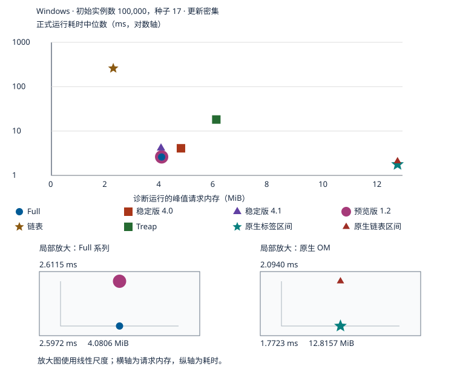
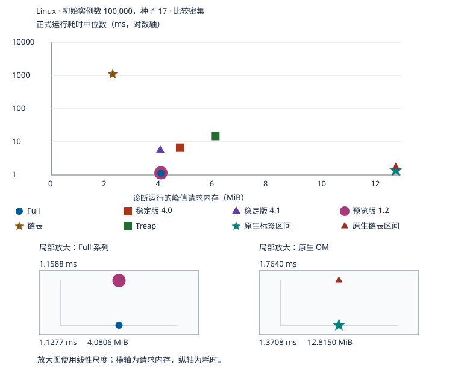
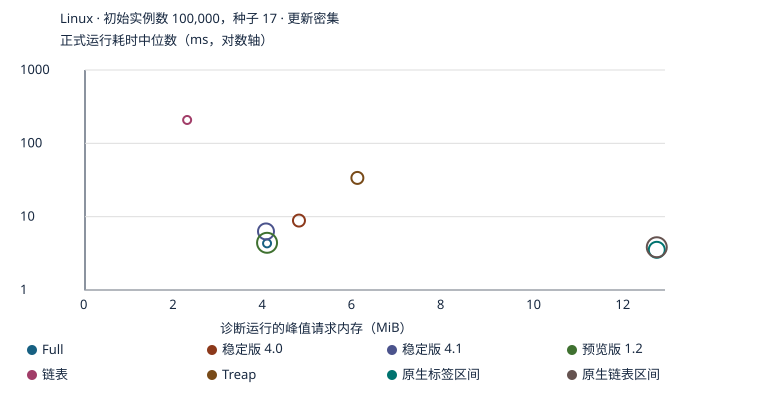

# Full v4.2.0 性能证据

[English](FULL_RC1_EVIDENCE.md)

Full v4.2.0 保留经 RC.1 集成的运行源码 `fe00536e7bd7f4e5128432ea4a29e54158074903`。表格及图形复用 Preview 存档实验，对应运行实现及其对照均未改变；Stable 元数据不引入实测算法变化。本文是当前汇总，历史阶段报告保持原样。

## 版本演进与比较边界

| 阶段 | 运行变更及出处 | 耗时与资源证据 |
| --- | --- | --- |
| Stable 4.0 → 4.1 | owner 下沉到块，快照行更紧凑。[4.1.0](V4_1_0.md) | 所测 x64 的 Resident 为 32 → 24 字节，行元数据为 16 → 8 字节。发布研究中的负载耗时另行记录。 |
| Preview.1 | 22544cf2 增加受影响区间回填和祖先比较。[证据](V4_2_0_PREVIEW1.md) | 在 GitHub 托管的 Windows/Linux 运行中，相对 4.1.0 总比 0.69786/0.70889（降低 30.2%/29.1%），比较密集 0.57230/0.56894；相对 4.0.0 总比 0.62587/0.66618。独立本地 Windows 相对 4.1.0 总比 0.72003，比较密集 0.54343。七项本地剖面的请求峰值相同。 |
| Preview.1.2 | 61e9290e 增加有界标签。[证据](V4_2_0_PREVIEW1_2.md) | 独立对照 Preview.1，Windows/Linux 降低 10.2%/11.4%，请求峰值最多增加 0.600%。 |
| Preview.1.2.1 | c977b0fd 增强诊断单调性检查。[历史](design/V4_2_0_LIVE_CORE_RESEARCH_HISTORY.md) | B32、B128、直接转移和纯中点方案被否决。运行计时路径无变更。 |
| Preview.2 | fe00536e 使用固定宽度的线格式转换。[证据](V4_2_0_PREVIEW2.md) | 所选解码条件 Windows/Linux 中位数降低 32.9%/50.6%，请求内存相同。 |
| Preview.3 / RC.1 | 754b3088 / 3ac82d26 验证偏移一字节和恢复后混合标签。[证据](V4_2_0_PREVIEW3.md) | 见下列同期结果。RC 元数据和验证未引入新的实测性能收益。 |

## 两平台同期实时顺序比较

比值为 Full 耗时除以对照耗时（Full/control elapsed time），降低比例为 (1 − 比值) × 100，加速倍数为 1/比值。表中依次列全部匹配条件耗时比的中位数、比较密集条件耗时比的中位数和全部条件中胜出的次数。相对 Stable 4.1，Full 的匹配条件耗时比中位数降低 Windows 37.1%、Linux 36.0%。

| 对照 | Windows 总体 / 比较密集 / 胜出 | Linux 总体 / 比较密集 / 胜出 |
| --- | --- | --- |
| Stable 4.0 | 0.593973 / 0.191293 / 45/45 | 0.540286 / 0.192341 / 45/45 |
| Stable 4.1 | 0.629106 / 0.197718 / 45/45 | 0.640047 / 0.219173 / 45/45 |
| Preview.1.2 | 0.994524 / 0.996669 / 29/45 | 0.998139 / 1.002047 / 24/45 |
| List | 0.027376 / 0.002536 / 45/45 | 0.028692 / 0.002982 / 43/45 |
| Threaded Treap | 0.124475 / 0.074047 / 45/45 | 0.106949 / 0.071966 / 45/45 |
| Native tag-range | 1.052438 / 0.907887 / 21/45 | 1.020154 / 0.907199 / 22/45 |
| Native list-range | 0.908532 / 0.623951 / 25/45 | 0.925724 / 0.681448 / 28/45 |

每图固定种子 17 和 100,000 个初始实例，纵轴使用对数尺度以覆盖全部八种实现。实心标记保留实测位置。先画较大的标记。线性放大图按原始坐标展示 Full 系列和原生 OM 的近邻点。精确值见坐标表。耗时为七次正式进程中位数，内存取同条件的独立诊断进程。比较密集时 Full 和原生 OM 的请求峰值分别为 4,278,776 和 13,437,504 字节，计数适用各自的分配器统计边界。请求峰值不包含未追踪的外部分配，也不等同保留字节、分配流量、线格式大小或进程工作集。原生 OM 在某些更新密集场景占优。Windows 短轨迹相对 Preview.1.2 最差为 1.424，配对复跑为 0.996；均保留。

在根目录执行 `python benchmarks/research/full-v4.2.0-rc.1/generate.py`。[派生数据、哈希与不利条件](../benchmarks/research/full-v4.2.0-rc.1/live-derived.json) 使用原始 [Windows](../benchmarks/research/full-v4.2.0-rc.1/../full-v4.2.0-preview.3/final-matrix/Windows/metadata.json) 和 [Linux](../benchmarks/research/full-v4.2.0-rc.1/../full-v4.2.0-preview.3/final-matrix/Linux/metadata.json) 的源码、编译器、主机和二进制清单。按规模、种子、场景及轨迹哈希分组。每条轨迹含 20,000 次操作，预热、七次正式样本和分配诊断分别采集。[协议](../benchmarks/research/full-v4.2.0-rc.1/../full-v4.2.0-preview.3/PROTOCOL.md) · [原始归档](../benchmarks/research/full-v4.2.0-rc.1/../full-v4.2.0-preview.3/final-matrix)。

## 散点坐标

| 平台 | 负载 | 实现 | 峰值请求字节数 | 耗时中位数（ms） |
| --- | --- | --- | ---: | ---: |
| Windows | 比较密集 | full | 4278776 | 0.602100 |
| Windows | 比较密集 | stable40 | 5028760 | 3.293100 |
| Windows | 比较密集 | stable41 | 4253752 | 3.232300 |
| Windows | 比较密集 | preview1 | 4278776 | 0.640100 |
| Windows | 比较密集 | list | 2400168 | 1664.274300 |
| Windows | 比较密集 | tree | 6400424 | 7.846000 |
| Windows | 比较密集 | tag | 13437504 | 0.572100 |
| Windows | 比较密集 | list_range | 13437504 | 0.788100 |
| Windows | 更新密集 | full | 4278800 | 2.597200 |
| Windows | 更新密集 | stable40 | 5028792 | 4.084900 |
| Windows | 更新密集 | stable41 | 4253776 | 4.128400 |
| Windows | 更新密集 | preview1 | 4278800 | 2.611500 |
| Windows | 更新密集 | list | 2400576 | 259.831300 |
| Windows | 更新密集 | tree | 6401512 | 18.185700 |
| Windows | 更新密集 | tag | 13438184 | 1.772300 |
| Windows | 更新密集 | list_range | 13438184 | 2.094000 |
| Linux | 比较密集 | full | 4278776 | 1.127721 |
| Linux | 比较密集 | stable40 | 5028760 | 6.663075 |
| Linux | 比较密集 | stable41 | 4253752 | 5.580504 |
| Linux | 比较密集 | preview1 | 4278776 | 1.158808 |
| Linux | 比较密集 | list | 2400168 | 1094.379312 |
| Linux | 比较密集 | tree | 6400424 | 14.941655 |
| Linux | 比较密集 | tag | 13437504 | 1.370782 |
| Linux | 比较密集 | list_range | 13437504 | 1.763961 |
| Linux | 更新密集 | full | 4278800 | 4.322430 |
| Linux | 更新密集 | stable40 | 5028792 | 8.847155 |
| Linux | 更新密集 | stable41 | 4253776 | 6.288885 |
| Linux | 更新密集 | preview1 | 4278800 | 4.402037 |
| Linux | 更新密集 | list | 2400576 | 208.157465 |
| Linux | 更新密集 | tree | 6401512 | 33.748477 |
| Linux | 更新密集 | tag | 13438184 | 3.532692 |
| Linux | 更新密集 | list_range | 13438184 | 3.829643 |

## 生命周期、应用与规模

| 比较 | Windows | Linux | 范围 |
| --- | ---: | ---: | --- |
| Final / flat | 1.137284 | 1.136323 | 每平台 13 个端点条件。 |
| Final / threaded Treap | 0.580369 | 0.526053 | 每平台 5 个任意相对编辑条件。 |

这里是进程墙钟时间；阶段耗时之和另计。覆盖 1k–100k 个实例、保留量 0/1/2/8/16、空关联至 4096 字节、命名空间 8/4096 字节。独立留出组覆盖额外状态和变化速率。受测 Treap 逐项恢复；批量恢复未测。回调、失败与来源保证不同。[复现说明](../benchmarks/research/full-v4.2.0-rc.1/../full-v4.2.0-preview.3/REPRODUCTION.md)。

OrdWeave 在内存和持久模式执行 27 条生成轨迹，702 项观测包括预热与剖面。相对 Preview.1.2 的操作耗时比为 1.001530 和 0.997323。准备与发布占内存模式 94.5%，WAL 占持久模式 96.6%，其中包含嵌套的 flush。生成的应用负载并非实际用户遥测。官方依赖仍为 4.1.0。[原生证据](https://github.com/RXY712200/OrdWeave/tree/ebfa5c62245f793e90fde590b577003839d3e0b1/benchmarks/research/full-preview3-20261125)。

受保护的稀疏实验覆盖 10k/100k/1m。1m 缩到 10,000 个 Handle 后，实时请求内存由 42,753,776 减到 431,576 字节。集中和分散的幸存实例在两个循环中保留身份。多百万实例、长期保留与无界标签恢复尚无测量。[规模证据](V4_2_0_PREVIEW2.md#step-5-resource-envelope-and-live-guard) · [选型指南](FULL_SELECTION_GUIDE.zh-CN.md)。
