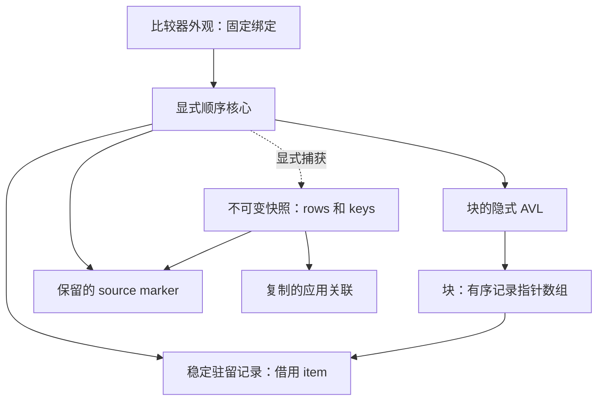

# V4 架构定义（历史中文对应版）

原文：[V4_ARCHITECTURE.md](V4_ARCHITECTURE.md)，英文，固定于 [`820599364961d5b29c6492323cb3e539ce1e2b0f`](https://github.com/RXY712200/LayerKeySort/blob/820599364961d5b29c6492323cb3e539ce1e2b0f/docs/design/V4_ARCHITECTURE.md)。原文保持不变。本文件对应历史 Stage 3 的选定设计；其中临时名称和策略不代表当前契约，最终 API、wire 和策略见 [V4_FREEZE](../V4_FREEZE.md)。[双语清单](V4_2_0_RC1_BILINGUAL_CHECKLIST.md)。

内容从 `3c0373f4bd62287766a84e79e9ee5dbc03194e38` 导入生产基线 `c33afa2ac08248bffa6dde51bd590a5d799b394a`，没有合并或挑选研究提交。历史阶段之后的实现范围见 [V4 Preview.1](../V4_PREVIEW1.md)。状态为 **Stage 3 选定架构，不是已实现或已发布的 V4 API**。起点 `cbf1862c63fa4e23bef4f1383df7e2b464051ae0`，当时生产仍为 v3.1.0，精确 C 名称、布局和新 wire 字节尚未冻结。[决策记录](V4_DECISIONS.md)区分证据、决策、前提与待实现工作。

## 1. 选择及证据边界

V4 使用一个有上下文的显式顺序核心、建立在该核心上的比较器托管外观，以及独立不可变的快照导出。驻留记录没有独立可排序 Path。隐式 AVL 索引排列有界块；块内是指向地址稳定驻留记录的有序指针数组。

选择 Phase 2 结果 **D — 需要混合方案**，不是 S/I 双引擎；S 只作实验参照。本文件不把原型 ABI、快照 token 或分配器作为生产代码采用。

当时审阅了公共头、Tree/OrderedTree、Path/LK1、Group/Batch、sort、allocator、ownership/API 文档，以及 [V3 迁移](../V3_MIGRATION.md)、[兼容性](../COMPATIBILITY.md)、[架构](../ARCHITECTURE.md)、[设计历史](../history/DESIGN_HISTORY.md)。固定研究证据为：

- [Phase 1](https://github.com/RXY712200/LayerKeySort/blob/3c0373f4bd62287766a84e79e9ee5dbc03194e38/docs/research/V4_ROOT_CAUSE_PHASE1.md)、[Phase 2](https://github.com/RXY712200/LayerKeySort/blob/3c0373f4bd62287766a84e79e9ee5dbc03194e38/docs/research/V4_ARCHITECTURE_PHASE2.md)。
- [F 尝试](https://github.com/RXY712200/LayerKeySort/blob/3c0373f4bd62287766a84e79e9ee5dbc03194e38/research/architecture/flat_attempt.py)、[I/S 实现](https://github.com/RXY712200/LayerKeySort/blob/3c0373f4bd62287766a84e79e9ee5dbc03194e38/research/architecture/models.c)、[声明](https://github.com/RXY712200/LayerKeySort/blob/3c0373f4bd62287766a84e79e9ee5dbc03194e38/research/architecture/models.h)。
- [语义轨迹与预言机](https://github.com/RXY712200/LayerKeySort/blob/3c0373f4bd62287766a84e79e9ee5dbc03194e38/research/architecture/campaign.py)、[回放适配器](https://github.com/RXY712200/LayerKeySort/blob/3c0373f4bd62287766a84e79e9ee5dbc03194e38/research/architecture/replay.c)及其测试。

Phase 1 将混合成本定位于坐标准备、被拒修复、验证与清理。Phase 2 在25个场景、162次回放中用独立扁平预言机核验上下文顺序。苛刻 timeline 中 I/S 的观察尾延迟和请求驻留载荷更小，但导出与反复局部写入仍有成本。这是单环境实验，不是证明或 V4 性能承诺。

证据勘误：大型 timeline 的捕获记录是 **五次重标记、其中四次全范围操作**，不是五次全范围；见决策记录，原报告及捕获不改。

## 2. 实体与所有权

| 实体 | 所有权与生命期 | 可变性及地址 | 公共观察及失效 |
| --- | --- | --- | --- |
| 显式顺序核心 | 调用者拥有容器；核心拥有记录、块、索引和 marker 引用 | 可变，销毁前地址稳定 | 不透明拥有对象，不可结构复制；销毁终止全部驻留 |
| 比较器外观 | 调用者拥有；外观独占核心及复制的比较器描述符 | 绑定固定 | 不暴露可变底层核心 |
| 应用 item | 调用者拥有载荷；记录借用指针 | 调用者管理数据及生命期 | 驻留或其他借用期间保持存活；库从不释放 |
| 驻留记录 | 核心每次驻留拥有一次分配 | 地址稳定；私下维护 owner/block/local index | 不透明 handle 指向它；remove 销毁记录 |
| item handle | 非拥有的不透明记录指针 | 驻留期间稳定 | 可复制；remove/destroy 使全部副本失效 |
| 块 | 核心拥有数组及内嵌索引节点 | 可变，合并/删除前地址稳定 | 不公开暴露或复制 |
| 块索引节点 | 内嵌块中 | 链接、高度、子树块数可变 | 物理形状私有 |
| 局部位置 | 私有记录数组下标 | 局部维护时变化 | 非公共持久 rank/identity |
| 核心 revision | 核心拥有 uint64 计数器 | 每次实际公共 mutation 加一 | 只对同一存活 source identity 有意义 |
| source marker | 核心及快照分别保留的不可变独立分配 | 最后引用释放前稳定 | 内部身份，不序列化为应用 ID |
| iterator | 调用者拥有游标，借用存活核心 | 捕获 revision/遍历状态 | 实际 mutation 失效；no-op/失败保留 |
| snapshot | 调用者拥有完成对象、缓冲及 marker 引用 | 不可变 | 跨 source mutation/destroy 存活；销毁终止借用 row/key view |
| snapshot row | 快照拥有 ordinal 和复制关联字节 | 不可变稳定缓冲 | 只读借用，可自行复制 |
| export key | 快照拥有字节，调用者可保副本 | 不可变 | 同 export domain 可比，不能输入 live position |
| Group | 调用者拥有不可变扁平数组，借用 items | 顺序固定 | item view 借用，无 live handle/Path |
| GroupBatch | 调用者拥有 builder/chunks，借用 items | 累积构建 | chunk 顺序决定等值优先，chunk 不是 live block |

初始 V4 保私有分配层，无公共 custom allocator。先核大小，对齐分配成功或失败；fault injection 私有。释放不失败、不调用 item 析构。不借未规定的 caller allocator context；后续 allocator 提案须另定 context/deallocation/synchronization 契约。



## 3. 已提交状态的基本不变量

AVL 中序块序为 `b0 ... b(M-1)`，每块为 `r0 ... r(k-1)`；全局驻留序是其串接。每记录恰出现一次，owner/block/local index 与该出现一致。已提交块不为空。parent links、AVL heights、subtree block counts、前后线程、缓存端点和 resident count 一致。

同核心两个 live records：同块比较 local indices；异块用 parent links/subtree block counts 计算块 rank。rank 是上下文计算值，不是发布标签。由此形成反对称、传递的全序。比较器相等的不同记录仍有不同位置；记录等于自身；跨容器是 domain error，非全局排序。

split 把一个子序列改成两个邻接子序列，串接不变；merge 串接邻块，redistribution 重新划分相同串接。move 删除一次出现并插入目标邻位；AVL rotation 保中序。无公共整块搬移，无半 split/半 move 可见状态。

```text
私有 AVL 中序：  block A       block B     block C
局部数组：      [r0,r1,r2]    [r3,r4]     [r5,r6]
全局顺序：      r0 < r1 < r2 < r3 < r4 < r5 < r6
稳定 handle：   指向记录，不指数组槽或块 rank
```

## 4. 局部块及顶层顺序

### 占用策略

初始策略为偶数 `B = 128`、`H = B/2`，B 至少八。B 为内部值，单核心生命期固定，后可调，非 wire/API 常量。每块内嵌 AVL 节点、邻居线程和 **B+1 个记录指针**连续存储；额外槽为 commit scratch，非稳态容量。记录本身不移动。

空核心无块；单块1..B项；多块每块H..B。满块插入先备一个 spare，将B+1分成floor/ceil两半（B128时64/65），至多一次split，无级联。

删除后H-1项选立即右邻，无则左。总数<=B则串接进左块、退役右块，否则同两块近半分配。现有数组足够，remove/merge/redistribute均不分配；唯一空块退役。

终止证明：邻块H..B，pair total为 `2H-1 .. B+H-1`。能merge时<=B且至少H；超过B时两半都H..B。删一记录只一个source underflow，无后续repair chain。此**选定规则强于 I 原型所测的可选merge**，实现须测试不能继承原型结果。

insert/delete指针移动及下标修复O(B)；同块move最多B项区间且占用不变；pair repair O(B)，无坐标深度增长。

### 隐式块 AVL

块上保 AVL balance、高度及子树**块**数。不需 per-resident rank array、物化 block labels、subtree item count 或公共 rank/select。块增删更新O(log M)祖先，已知handle直接定位块。threads及cached first/last提供O(1)邻步和O(N)遍历，export无需原型I逐row查rank。

复用已测balance机制而不重开索引竞赛。连续数组利于局部访问，但独立records/headers仍有indirection/allocator成本，不声称未测cache改善。

## 5. Handle 与借用生命期

handle跨其他insert/remove、同/跨块move、split/merge/redistribute/rotation保持身份，仅自身remove或core destroy失效。remove可返借用item，释放record不释放item；地址即使复用，reinsert仍新residence。

**不保证检测 dangling handle。** 不可把已free handle传API；owner字段可拒still-live foreign，不能安全验证free storage。handle不可serialize/按数值排序/作business ID；identity equality仅对live handles。同一item pointer可两次驻留且handle不同。

无借用live coordinate；getter借caller payload。first/last/next/previous返逻辑handle。remove current前存next有效，前提next本次residence仍live。

iterator借core并捕获revision；任意actual mutation使失效，即便handles仍存。**先验revision再读cached record/block**；failed及successful no-op保有效。iterator不能比core活得久，revision不能验证已毁core。

revision从零，每actual public mutation一次，不按rotation/split；永不wrap。到UINT64_MAX，would-be mutation在commit前拒，query/snapshot/no-op/destroy仍可。重建core有新handle/marker，防counter复用使旧cursor/snapshot重获current。

## 6. 概念操作与比较器组合

以下是语义名，非冻结C声明。

| 操作 | 契约 |
| --- | --- |
| insert front/back | 端点新驻留，空核心两者均可 |
| insert before/after | 需live同core anchor，非snapshot key |
| remove | 精确handle，可返item，无分配，其他handle存活 |
| move before/after | moved/anchor均live同core，保identity/count |
| move front/back | 端点移动，无跨容器transfer |
| move no-op | self-anchor/已相邻/已端点成功且revision不变 |
| first/last | 空核心空结果，无物理root暴露 |
| next/previous | 逻辑邻居，端点空结果 |
| compare | 同core驻留序，非comparator equality或history order |
| iterate | revision检查遍历 |
| size | 常数resident count |
| destroy | 终止驻留，释放core storage不释放items |

同块move只变数组。跨块目标满时**unlink前**备spare。commit从source移除，按still-live destination handle插入，需要则split，再按**插入后的邻块**修source underflow。不能在remove/maintenance后用缓存anchor ordinal；private commit中source可暂空。

source repair可能涉及刚split的destination；更新受影响数组最终record locations，不能假原block assignment仍存。至多一destination split、一source pair repair，触及至多四个不同block arrays。records/links提交后才free退役块，无distance scan/deferred queue。

### 比较器托管外观

一facade独占private core，复制descriptor，callback/context在其生命期借用，binding固定。公开ordered insertion/lookup/logical iteration/handle removal/snapshot，无任意move或mutablecore escape。

查首comparator-equal：找首max>=query块，再local lower bound并验equal。missing显式，不从export key伪造live handle；neighbor/bound query用上下文search。

comparator为一致total preorder，semantics/context及resident可见数据稳定。改key需remove、change、reinsert，分操作非payload原子事务。handle remove不调comparator；不一致collection的ordered query/insert无正确性承诺，也不自动scan数据变化。

稳定等值用upper bound：找首max严格>query块，在块内binary upper bound，否则append。全equal块被balanced search跳过，非successor扫描。目标比较次数O(log M+log B)，另乘callback cost；Group/Batch source等值优先不变。

## 7. 不可变快照与export domain

snapshot捕特定逻辑序/source revision/flat ordinal0..N-1/可选每occurrence caller associations，拥有全部rows/bytes，不保livehandle/block/itempointer/旧corepointer。key编码snapshot ordinal非live blockrank/local，独立capacity/split/index shape。

可选callback收borrowed item和ordinal，返byte span立即copy，不留callerpointer。允许重复business IDs，ordinal分occurrence；同对象多驻留的持久用户应给occurrence IDs。无association只捕order，不足还原payload mapping。

checked row array/key pool，加几何增长或chunk association storage，一次遍历无rankquery/Path generation；目标O(N+A+callback)，storage O(N+A)，A为总association bytes。避免quadratic concatenation/不必要第二N-item traversalarray。OOM/overflow/callback失败清prepare、output NULL、core不变。

caller对mutation及相关payloadchange串行capture。per-core guard拒同core callback reentry（含read）；callback正常返回，不throw穿C或longjmp，callback看不到structuralcommit。

### 历史有效性与currentness

core拥有独立immutable source marker引用，snapshot独立retain；core destroy释放自身引用，不毁snapshot。snapshot保marker时其地址不可复用，因此core地址复用不会假匹配。

currentness显式接livecore，比较markeridentity+revision，snapshot从不解引用旧core。任意mutation/itemdestroy/coredestroy后rows仍可读；serialized snapshot保history，非重启有效currentness。

currentness是**order revision**，不是当前payload/association。manual payload/external IDs变化库不追踪；capturedassociation保持历史，应用自行version并在状态变时新namespace。

markerretain/release须overflow-safe且跨独立destroy原子，这是lifetime bookkeeping非locking；portable C17/MSVC backend/tests当时待实现，非已有能力。

immutable Group也可capture：自有marker、固定revision零、同association/domain规则；Groupdestroy释marker，完成snapshot仍存，且不retainGroup借用item。Batch在immutable result前非capture source。

### 新key家族：语义要求，非最终字节语法

新versioned snapshot-order family，**不复用LK1/AI1/AS1**，wire/golden为后Preview gate：

- deterministic canonical printable ASCII，显式family/version。
- 复制caller namespace，指一个immutable snapshotstate；外部唯一性由caller保证，无隐含随机全局ID。
- order-preserving ordinal，选unsigned64bit；count/length还须fit接收SIZE_MAX，否则拒不截断。
- 同version/namespace，strcmp序等于row序；DB collation须保ASCII字节。
- 同logical order/associations/namespace，keys相同且独立topology；空snapshot无rowkey。
- 验version/domain/overflow/canonicality，不兼容须新version。

domain为 `(format version, export namespace)`。不同snapshot状态不能同namespace，仅完全相同immutable状态（含association）可复用；localcode不证明global uniqueness。内存marker/revision为provenance非persisted namespace。

semantic跨domain compare拒；raw strcmp能排字节但**无跨domain驻留序意义**。同business item跨snapshot无precedence保证。复制keys在原domain仍可排序，historykeys不是live move输入。

完成snapshot可stream storage，必须capture完整后publish非incremental。stream失败可能partial externalwrite，库不回滚I/O；atomic save用tempfile/transaction。初始不含delta/incremental export。

## 8. 持久化与V3迁移

保存manifest（family/version/namespace/rowcount）、canonical ordered keys、copied occurrenceassociation、独立version callerpayload。source revision为historymetadata非restartidentity。

load验syntax/onedomain/checked sizes-counts/unique complete ordinal序；resolveassociation到borroweditems，再建fresh至少half-full blocks+balancedindex。已排序输入O(N+A)不含resolver；未排另O(N log N)key comparisons。missing/duplicate ordinals或manifestcount不符失败。

全prepare/全validate才publish，无partialcore；resolver外部副作用不回滚，失败load中callercreateditems由caller释放，库不freepayload。load保**logicalorder**，不保handle/topology/revision/processcurrentness。保原artifact才保精确historykeys，新core export通常新namespace/key，snapshot间无需持续live坐标字符串。

V3迁移经隔离tool/companion中不变publishedLK1codec：strictdecode，拒unsupported/noncanonical/overflow，bytewise排序，恢复旧Tree时验Pathunique，resolveassoc，bulkbuildV4。不同旧Path可同itempointer但不同occurrence。禁止strcmp显示文本；V4core接ordereditems，不依V3Pathinternals。

## 9. prepare/commit失败原子性

| 操作 | prepare | 无分配commit |
| --- | --- | --- |
| insert | 验anchor/count/revision/arithmetic；分配record及空/满目标block | shift/link/可选split/index-count/一次revision，publishhandle |
| delete | 验livehandle/revisioncapacity，无分配 | remove/一次neighborrepair/index-count/退record-block/返item |
| 同块move | validate及no-op判断 | interval shift/indexrepair/一次revision |
| 跨块move | validate/no-op；满目标备spare | remove/insert/一次split-source repair/final locations-index/一次revision |
| split | 父操作备spare | 分B+1指针，插邻block/indexnode |
| merge/redistribute | 现数组足够 | 保串接、更新locations-links-index，unlink后退右block |
| AVL change | 既有/预备embeddednode，checkedoverflow | rotations/ancestorcounts-heights/threads |
| snapshot | 验length/domain，alloc/copy/safemarkerretain | publish完整result，无livemutation |
| bulkload/Groupbuild-merge | 独立result全preparevalidate | publish，sources不变 |

commit前失败，order/record locations-address/handles/revision/iterators/snapshot/borrowedpayload association不变；清unpublishedprepare，可失败工作前output置空。commit开始不allocation/comparator/associationcallback/I/O；references一致后nonfailingfree，allocatorlatency不受界。跨move OOM保原position/handle；remove-change-reinsert非generalatomictransaction。

## 10. V3概念处置

| V3概念 | 处置 | 理由/迁移 |
| --- | --- | --- |
| LksPath | 主V4core API移除 | contextualresidence替standalonehierarchy；可留V3 |
| LK1 | core移除，保V2/V3codec迁移契约 | 不重解释v1为snapshotdomain |
| LksTree | 替换 | relativepositioncore，无arbitraryPathinsert/rekey |
| LksOrderedTree | 保用途、重定facade | oneprivatecore/fixedbinding/stableequality |
| LksTreeNode | 替换 | stableresidenthandle，隐藏physicaltopology |
| Group | 保语义、重定storage | immutableflatborrowedarray，无Path/index生成 |
| GroupBatch | 保语义、重定storage | sourcechunk等值稳定，非liveblocks |
| comparatorbinding | 基本保 | copieddescriptor、borrowedstablecallback/context/data |
| physicalAVL | 保机制、重定单位 | contextualblocks，无Pathkeys |
| publicchild/rootnavigation | 移除 | logicalneighbors有用，physicalshape限制演进 |
| managedinsert | 替换 | upperbound+boundedblocks，无coordinaterepair |
| rekey | 移除、以move取其用途 | handle-relative非arbitrarycoordinate替换 |
| serialization | 替换 | snapshotdomain+logicalrestore |
| lks_sort | 保stableconvenience | 无须重设算法 |

Group stable-sort复制itemarray，merge新array不改source，equalBase先Incoming；Batch earlierchunk优先。退出GroupPathaccess，保count/item及explicitsnapshot，无Groupresidenthandle。calleritems对全部Group/Batch使用须live；orderimmutable不使payloadimmutable或库拥有；mergecomparator要求sourcearrays仍兼容。

major sourcebreak有意。hierarchy用户留V3或applicationmap，不用暗重建Path的shim。ordered用户node/Path转handles，GroupPath转export；此时新名字未freeze。

## 11. 线程与callback

无内部mutablecore locks，mutation/capture涉及时caller串行samecore，无read并发mutation。quiescent多read在comparator/payload安全时可；separatecores独立，但共享calleritems/context仍须sync。

snapshotimmutablebuffers在生命期有保障时可并发读，destroy/readrace为callererror。atomicmarker仅保隐藏共享life，非operations threadsafe。私globalfault/diag tests串行。reentryguard不是mutex或无sync调用许可；caller同步comparator/identity-payloadserialization/另提allocatorcontext；callback不可逃受控C执行。

## 12. 复杂度及storage目标

N resident、M blocks、B capacity、A associationbytes。H=B/2，非空 `M <= max(1, 2N/B)`。以下为选定结构目标，**非已有V4实现保证**。log含M0/1常数工作，用log(1+M)。residentcount须fit SIZE_MAX及UINT64_MAX，insert/load前拒overflow；查所有arrayproduct/poolsum/terminator。

| 操作 | 目标 | 分配/工作范围 |
| --- | --- | --- |
| known-positioninsert | O(B + log M) | record+可选一block，localarrays/indexpaths |
| remove | O(B + log M) | 不分配，一source repair |
| 同块move | O(B) | 不分配/index不变 |
| 跨块move | O(B + log M) | 可选spare，至多四不同arrays |
| managedinsert/lookup | O(log M + log B)比较，另insert | callback另计，无equalrun长度因子 |
| handlecompare | 同块O(1)，异块O(log M) | computedranks，不分配 |
| endpoints/neighbors/size | O(1) | cachedendpoints/threads |
| iterate | O(N) | revisionchecked |
| snapshot | O(N+A)+callback | 显式O(N+A)result，无逐rowrank |
| orderedbulkload | O(N+A)+resolver | 全resultprepare |
| Groupbuild/merge | O(N log N)/O(N)+comparator | 显式resultallocation |
| destroy | O(N+M)+deallocation | 全cleanup |

普通mutation不得rewrite无界unrelatedresident。允许logindexmetadata，computedsuffixrank可变但不写suffixrecords。无deferredmaintenance/globalrelabel；不推出realtime/wallclock/wholelibraryformal amortized。

residentorderingstorage目标：

`N*sizeof(record) + M*(sizeof(block header)+(B+1)*sizeof(pointer)) + O(1)`。

owner/itempointer/threads使比Iresearchminimum大，实测约36bytes/item非V4承诺。测allocatoroverhead/fragmentation-RSS/splitpeaks/retainedsnapshots。churn释removedrecords/blocks，无历史handleregistry/livecoordinatedepth增长；historymemory仅刻意保留snapshot增长。

## 13. Preview验收gates

采用前需：

1. independentflatoracle differential、全部Phase2families/equality/owner-revision-noop/drainempty。
2. randomized每步AVL/thread/occupancy/location，含destinationsplit改变sourcerepairneighbor的crossmove。
3. counters验证一split/一sourcerepair/boundedarrays/logancestors/无fullrewrite-debt，fieldwritebound由实际实现推导非原型宽envelope。
4. insert/split/move/snapshot/load每failpoint及associationfailure，state/revision不变/outputempty/noleak/可得sanitizer。
5. longchurn/grow-shrink RSS/allocator，metadata按当前N/B界，无tombstone/highwaterregistry。
6. ascending/descending/random/equal/duplicates/alternating/hotspot/timeline/priority-local-distantdrag/churn、多scale、可行millionendpoint；V3reference非每percentile必胜。
7. 分mutation/query/export/cleanup allocation/work，计反复localreindex非免费。
8. 同trace每100/1000/10000ops export、retained/source destroy、totalapplicationcost/key-assocstorage。
9. wiregrammar/golden/malformed-overflow-domain/bytecollation/crossplatform/save-destroy-load occurrenceequivalence。
10. supportedcompilers/consumers、markerlifetimeconcurrency/reentry测试后才可超specifiedthreadcontract声明。

不冻microsecondthreshold。实质allocator/exportheavy回归，Stable前须有据implementation-policy review或适用性限制，不藏mutation-only图。

## 14. 十三个压力推演

这是designargument，不是新V4实测。

| 场景 | 不变量与工作 |
| --- | --- |
| 极小gap反复insert | neighbor给contextposition，boundedshift/split，无numericgap收缩 |
| 1,000,000升序 | lastblockappend/split，O(B+log M)，分record/block，无全orderrefresh |
| 全equalmanaged | upperbound跳equalmax，equal后append，有界insert |
| alternatingadversarial | endpoint/neighbor直接定位，localrepair，无encoding/debt |
| repeatedlocaldrag | intervalshift/boundedcrossmove，handle稳定，actualmove使iterator失效 |
| longdistancemove | handle无距离scan，一split/repair、logindex |
| deletionchurn | 一merge/redistribute复occupancy，释storage，无deadregistry |
| crossmoveOOM | spare在unlink前失败，position/handle/revision/cursor不变 |
| splitOOM | record/spareprepare失败，无已提交overcapacity/partialhandle |
| snapshot后多mutation | ownedrows-keys-marker存，revision变currentness不变旧bytes |
| 两historysnapshot | 各domain/associmmutable，拒跨domainorder，无暗改currentkey |
| save/destroy/load | manifest-ordinal-occurrence还原order，新layout/handle/marker；旧artifact仍history |
| V3LK1迁移 | strictdecode/bytesort建逻辑序，freshV4，不重解释bytes |

## 15. 非目标及未决实现

非目标：CRDT/replicaorder、DBengine、businessidentity/payloadowner、scene framework、operationlocks、restartpersistenthandles、generaltransaction、incrementalexport、publicrank/select、crosscontainermove、automaticfreedpointervalidation。显式O(N)capture是真tradeoff。

当时待做：exactC signatures/status、packing/allocatoroverhead、checkedrevision-ordinal-count、AVLdetach/threads、fieldwriteenvelope/crossmove、portableatomicmarker、namespacewidth/wiregrammar、associationstorage/loadAPI、migrationpackaging/platformevidence。这些是实现gates，非多个主架构。

context-freelivekeys、zerocostexport、failsafedanglingvalidation均非承诺，需要者可选V3或另有据未来提案。

**Stage3：架构定义PASS。** 非V4release/implementation批准；更强blockpolicy仍需实现测试。
