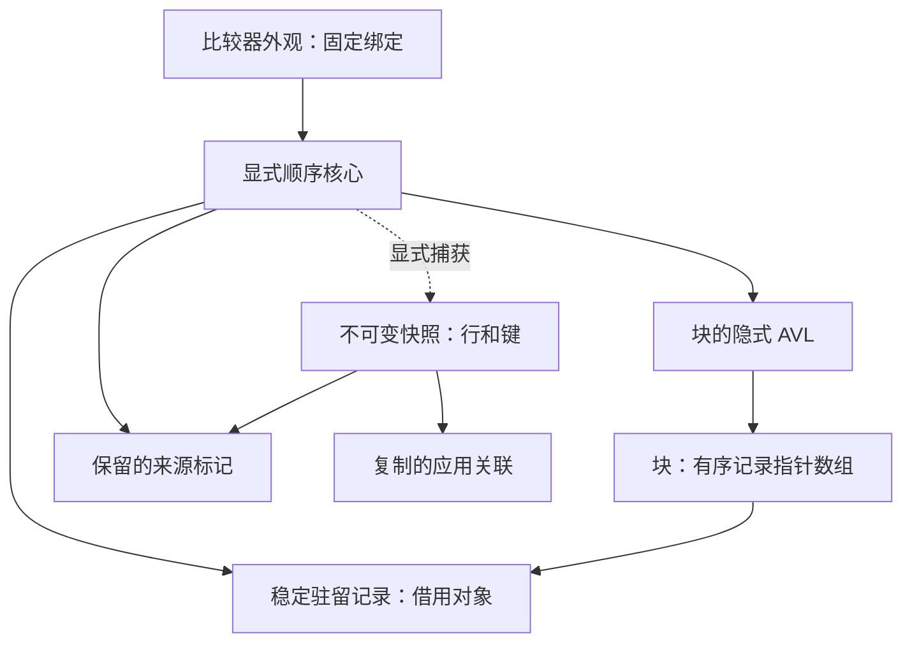

# V4 架构定义（历史中文对应版）

原文：[V4_ARCHITECTURE.md](V4_ARCHITECTURE.md)，英文，固定于 [`820599364961d5b29c6492323cb3e539ce1e2b0f`](https://github.com/RXY712200/LayerKeySort/blob/820599364961d5b29c6492323cb3e539ce1e2b0f/docs/design/V4_ARCHITECTURE.md)。原文保持不变。本文件对应历史 Stage 3 的选定设计；其中临时名称和策略不代表当前契约，最终 API、线格式和策略见 [V4_FREEZE](../V4_FREEZE.md)。[双语清单](V4_2_0_RC1_BILINGUAL_CHECKLIST.md)。

内容从 `3c0373f4bd62287766a84e79e9ee5dbc03194e38` 导入生产基线 `c33afa2ac08248bffa6dde51bd590a5d799b394a`，没有合并或挑选研究提交。历史阶段之后的实现范围见 [V4 Preview.1](../V4_PREVIEW1.md)。状态为 **Stage 3 选定架构，不是已实现或已发布的 V4 API**。起点 `cbf1862c63fa4e23bef4f1383df7e2b464051ae0`，当时生产仍为 v3.1.0，精确 C 名称、布局和新线格式字节尚未冻结。[决策记录](V4_DECISIONS.md)区分证据、决策、前提与待实现工作。

术语约定：residence 为“驻留关系”，resident record 为“驻留记录”，source marker 为“来源标记”，revision 为“修订号”，export domain 为“导出域”。threaded predecessor/successor links 为块的“前驱／后继链接”，不是并发线程。代码中的 API 名称和标识符保持原样。

## 1. 选择及证据边界

V4 使用一个有上下文的显式顺序核心、建立在该核心上的比较器托管外观，以及独立不可变的快照导出。驻留记录没有独立可排序 Path。隐式 AVL 索引排列有界块；块内是指向地址稳定驻留记录的有序指针数组。

选择 Phase 2 结果 **D — 需要混合方案**，不是 S/I 双引擎；S 只作实验参照。本文件不把原型 ABI、快照令牌 或分配器作为生产代码采用。

当时审阅了公共头、Tree/OrderedTree、Path/LK1、Group/Batch、排序、分配器、所有权及 API 文档，以及 [V3 迁移](../V3_MIGRATION.md)、[兼容性](../COMPATIBILITY.md)、[架构](../ARCHITECTURE.md)、[设计历史](../history/DESIGN_HISTORY.md)。固定研究证据为：

- [Phase 1](https://github.com/RXY712200/LayerKeySort/blob/3c0373f4bd62287766a84e79e9ee5dbc03194e38/docs/research/V4_ROOT_CAUSE_PHASE1.md)、[Phase 2](https://github.com/RXY712200/LayerKeySort/blob/3c0373f4bd62287766a84e79e9ee5dbc03194e38/docs/research/V4_ARCHITECTURE_PHASE2.md)。
- [F 尝试](https://github.com/RXY712200/LayerKeySort/blob/3c0373f4bd62287766a84e79e9ee5dbc03194e38/research/architecture/flat_attempt.py)、[I/S 实现](https://github.com/RXY712200/LayerKeySort/blob/3c0373f4bd62287766a84e79e9ee5dbc03194e38/research/architecture/models.c)、[声明](https://github.com/RXY712200/LayerKeySort/blob/3c0373f4bd62287766a84e79e9ee5dbc03194e38/research/architecture/models.h)。
- [语义轨迹与预言机](https://github.com/RXY712200/LayerKeySort/blob/3c0373f4bd62287766a84e79e9ee5dbc03194e38/research/architecture/campaign.py)、[回放适配器](https://github.com/RXY712200/LayerKeySort/blob/3c0373f4bd62287766a84e79e9ee5dbc03194e38/research/architecture/replay.c)及其测试。

Phase 1 将混合成本定位于坐标准备、被拒修复、验证与清理。Phase 2 在25个场景、162次回放中用独立扁平预言机核验上下文顺序。苛刻时间线 中 I/S 的观察尾延迟和请求驻留载荷更小，但导出与反复局部写入仍有成本。这是单环境实验，不是证明或 V4 性能承诺。

证据勘误：大型时间线 的捕获记录是 **五次重标记、其中四次全范围操作**，不是五次全范围；见决策记录，原报告及捕获不改。

## 2. 实体与所有权

| 实体 | 所有权与生命期 | 可变性及地址 | 公共观察及失效 |
| --- | --- | --- | --- |
| 显式顺序核心 | 调用者拥有容器；核心拥有记录、块、索引和 来源标记引用 | 可变，销毁前地址稳定 | 不透明拥有对象，不可结构复制；销毁终止全部驻留 |
| 比较器外观 | 调用者拥有；外观独占核心及复制的比较器描述符 | 绑定固定 | 不暴露可变底层核心 |
| 应用对象 | 调用者拥有载荷；记录借用指针 | 调用者管理数据及生命期 | 驻留或其他借用期间保持存活；库从不释放 |
| 驻留记录 | 核心每次驻留拥有一次分配 | 地址稳定；私下维护 所有者／所属块／局部下标 | 不透明句柄指向它；移除操作销毁记录 |
| 对象句柄 | 非拥有的不透明记录指针 | 驻留期间稳定 | 可复制；移除／销毁 使全部副本失效 |
| 块 | 核心拥有数组及内嵌索引节点 | 可变，合并/删除前地址稳定 | 不公开暴露或复制 |
| 块索引节点 | 内嵌块中 | 链接、高度、子树块数可变 | 物理形状私有 |
| 局部位置 | 私有记录数组下标 | 局部维护时变化 | 非公共持久 秩／身份 |
| 核心修订号 | 核心拥有 无符号64位计数器 | 每次实际公共变更 加一 | 只对同一存活 来源身份 有意义 |
| 来源标记 | 核心及快照分别保留的不可变独立分配 | 最后引用释放前稳定 | 内部身份，不序列化为应用 ID |
| 迭代器 | 调用者拥有游标，借用存活核心 | 捕获 修订号／遍历状态 | 实际变更 失效；无操作／失败保留 |
| 快照 | 调用者拥有完成对象、缓冲及 来源标记引用 | 不可变 | 跨 来源变更／销毁 存活；销毁终止借用 行／键视图 |
| 快照行 | 快照拥有 序号和复制的关联字节 | 不可变稳定缓冲 | 只读借用，可自行复制 |
| 导出键 | 快照拥有字节，调用者可保副本 | 不可变 | 同 导出域 可比，不能输入 实时位置 |
| Group | 调用者拥有不可变扁平数组，借用对象 | 顺序固定 | 对象视图为借用，不提供实时句柄或 Path |
| GroupBatch | 调用者拥有 构建器／数据块，借用对象 | 累积构建 | 来源数据块顺序决定等值优先；它不是实时顺序块 |

初始 V4 保私有分配层，无公共 自定义分配器。先核大小，对齐分配成功或失败；故障注入 私有。释放不失败、不调用 应用对象析构。不借未规定的 调用者分配器上下文；后续 分配器提案须另定 上下文／释放／同步 契约。



## 3. 已提交状态的基本不变量

设 AVL 中序遍历的块序列为 `b0 ... b(M-1)`，每个块包含记录序列 `r0 ... r(k-1)`。将这些局部序列依次连接，即得到全局驻留顺序。每条记录恰好出现一次，其所有者、所属块和局部下标必须与实际位置一致。已提交的块不为空。父链接、AVL 高度、子树块数、前驱／后继链接、缓存的首尾块以及驻留数量必须相互一致。

比较同一核心中的两个存活记录时：

1. 同块记录比较局部下标。
2. 异块记录依据父链接和子树块数计算块秩。秩是依赖容器上下文的计算结果，不是对外发布的标签。

由此定义反对称、传递的驻留全序。比较器判为相等的不同记录仍占据不同位置；记录与自身相等。跨容器比较属于域错误，不定义全局顺序。

块分裂将一个子序列替换为两个相邻子序列，两者连接后的顺序不变。合并连接相邻块；重新分配则重新划分同一连接序列。移动先移除一次出现，再插入指定邻接位置。AVL 旋转保持块的中序顺序。没有公共的整块搬移操作，也不会暴露分裂或移动只完成一半的状态。

```text
私有 AVL 中序：  block A       block B     block C
局部数组：      [r0,r1,r2]    [r3,r4]     [r5,r6]
全局顺序：      r0 < r1 < r2 < r3 < r4 < r5 < r6
稳定 handle：   指向记录，不指数组槽或块 rank
```

## 4. 局部块及顶层顺序

### 占用策略

历史设计的初始策略是偶数 `B = 128`、`H = B/2`，且 B 至少为八。B 是内部参数，在单个核心生命期内固定，以后可以调整，不是线格式或 API 的排序常量。每块包含内嵌 AVL 节点、前驱／后继链接，以及可连续存放 **B+1 个记录指针**的数组。额外槽仅供提交期间暂存，不属于稳态容量；记录本身的内存地址不变。

已提交状态的占用要求：

- 空核心没有块。
- 只有一个块时，包含 1..B 项。
- 有多个块时，每块包含 H..B 项。

向满块插入前，先准备一个备用块；随后将 B+1 项按向下／向上取整分成两半，B128 时为64/65。一次插入至多分裂一次，不发生级联分裂。

删除使某块只剩 H-1 项时，优先选择紧邻的右块，没有右块才选左块。若两块总数不超过 B，则将连接序列存入左块，退役右块；否则将该序列近似均分到原来的两个块。现有数组足以完成这些操作，因此移除、合并和重新分配均不需要分配内存。唯一块变空时，将其退役。

修复终止的理由如下：邻块占用为 H..B，因此两块总数介于 `2H-1 .. B+H-1`。可以合并时，总数不超过 B 且至少为 H；超过 B 时，重新分配得到的两半均介于 H..B。移除一条记录只会使一个来源块占用不足，因而不会继续触发修复链。这个**选定设计规则强于 I 原型中经过测试的可选合并策略**；新实现必须自行测试，不能直接继承原型测试结论。

插入和删除移动指针并更新下标，工作量为 O(B)。同块移动只移动至多 B 项的区间，块占用不变。成对修复也是 O(B)，不涉及坐标深度增长。

### 隐式块 AVL

在块上维护 AVL 平衡、高度和子树**块**数。不需要逐驻留项的秩数组、物化块标签、子树项数或公共秩查询／选择接口。块的插入和删除更新 O(log M) 个祖先；已知句柄可直接定位所属块。前驱／后继链接及缓存的首尾块提供 O(1) 逻辑邻居访问和 O(N) 遍历，因此导出不必像 I 原型那样逐行查询块秩。

这复用了经过测试的平衡机制，而不重新开展索引结构竞赛。连续指针数组提供局部访问，但独立记录和头部仍有间接访问与分配器开销；本设计不声称尚未测量的缓存收益。

## 5. 句柄与借用生命期

句柄在其他项插入或移除、同块或跨块移动、块分裂、合并、重新分配及 AVL 旋转后仍保持身份。只有自身驻留关系被移除或核心被销毁才失效。移除可以返回借用的应用对象，释放记录但不释放对象。重新插入建立新的驻留关系，即使分配器复用了原地址也是如此。

**不保证检测悬空句柄。** 不得将已经释放的句柄传入 API。所有者字段可以拒绝仍存活但属于其他核心的句柄，却不能安全验证已释放内存。句柄不可序列化、按指针数值排序或充当业务 ID；身份相等比较仅适用于存活句柄。同一个应用对象指针可以驻留两次，并具有两个不同句柄。

不存在借用的实时坐标。对象访问函数借用调用者的载荷。首项、末项、前项和后项查询返回逻辑顺序中的存活句柄。移除当前项之前保存下一项句柄是有效的，前提是下一项自身仍保持驻留。

迭代器借用核心并捕获修订号。实际变更会使迭代器失效，即使句柄仍然存活。必须**先比较修订号，再解引用缓存的记录或块状态**。失败操作和成功的无操作保留迭代器有效性。迭代器不能比核心活得更久；修订号检查不能验证已销毁的核心。

修订号从零开始，每次实际公共变更增加一次，不因旋转或分裂分别增加，且永不回绕。在 `UINT64_MAX` 时，需要变更状态的操作必须在提交前被拒绝；查询、快照、无操作和销毁仍然可用。重建的新核心具有新句柄和来源标记。这个容量错误防止旧游标或快照因计数器复用而重新成为当前状态。

## 6. 概念操作与比较器组合

下列名称描述语义，不是冻结的 C 声明。

| 操作 | 契约 |
| --- | --- |
| 首端／末端插入 | 在端点建立新驻留关系；空核心中两者均可 |
| 在前／在后插入 | 需要同核心的存活锚点，不能使用快照键 |
| 移除 | 精确句柄，可返回应用对象；不分配内存，其他句柄存活 |
| 移至锚点之前／之后 | 被移动项和锚点均须存活且属于同核心；身份及数量不变 |
| 移至首端／末端 | 仅端点移动，不进行跨容器转移 |
| 移动无操作 | 自身锚点、已经处于所需邻接位置或端点时成功，修订号不变 |
| 首项／末项 | 空核心返回空结果，不暴露物理根 |
| 前项／后项 | 返回逻辑邻居，越过端点返回空结果 |
| 比较 | 比较同核心的驻留顺序，不是比较器相等性或历史顺序 |
| 遍历 | 检查修订号的遍历 |
| 大小 | 常数时间取得驻留数量 |
| 销毁 | 终止驻留生命期，释放核心存储，不释放调用者对象 |

同块移动只修改该块数组。跨块移动且目标块已满时，在**摘除来源记录前**准备一个备用块。提交阶段从来源移除，按仍存活的目标句柄插入，需要时分裂，然后使用**插入后的邻块**修复来源占用不足。移除或维护后不得使用缓存的锚点序号。私有提交过程中，来源块可以暂时为空。

来源修复可能涉及刚分裂的目标块。必须更新受影响数组中记录的最终位置，不能假定原所属块不变。至多发生一次目标分裂和一次来源成对修复，触及至多四个不同块数组。记录位置及链接提交一致后才释放退役块。没有按移动距离扫描或延后工作队列。

### 比较器托管外观层

一个外观层独占私有核心。复制比较器描述符，在外观层生命期内借用回调及上下文，绑定固定。公开有序插入、查找、逻辑遍历、按句柄移除和快照；不公开任意顺序移动或可变底层核心。

查找首个比较器相等的驻留项时，先找最大值大于或等于查询值的首块，再作块内下界查找并验证相等。未找到必须明确返回，不得从导出键伪造存活句柄。邻居及边界查询使用这些上下文查找。

比较器定义一致的全预序。其语义、上下文以及驻留项中对比较器可见的数据必须稳定。改变排序键需要依次移除、修改、重新插入；这是分开的操作，不是载荷原子事务。按句柄移除不调用比较器；已有集合不再满足排序前提时，有序查询和插入不保证正确，也不会自动扫描检测数据变化。

稳定等值采用上界：查找最大值严格大于查询值的首块，再在该块内二分查找上界；没有这样的块则追加。全等块通过平衡索引跳过，不线性扫描后继。目标比较器调用次数为 O(log M + log B)，实际成本另乘回调成本。Group/Batch 的来源等值优先规则不变。

## 7. 不可变快照与导出域

快照捕获某个逻辑序列、来源修订号、扁平序号 0..N-1，以及可选的调用者提供的逐次出现关联数据。它拥有全部行和字节，不保留存活句柄、块、应用对象指针或旧核心指针。键编码快照序号，不编码实时块秩或局部位置，因此顺序独立于容量、分裂和索引形状。

可选关联回调接收借用对象及序号，返回字节区间，库立即复制，不保留调用者指针。允许重复业务 ID，序号区分不同出现。同一对象多次驻留时，持久化用户应提供出现身份。没有关联数据的快照只捕获顺序，不足以恢复载荷映射。

先检查大小，再分配行数组和键存储池；复制的关联数据存储按几何增长或分块组织。遍历一次，不查询秩或生成 Path。目标为 O(N+A+回调工作)，存储 O(N+A)，A 是关联数据总字节数。避免二次方缓冲拼接和不必要的第二个 N 项遍历数组。内存不足、溢出或回调失败时清理准备状态，输出为 NULL，核心不变。

调用者必须将捕获与变更及相关载荷修改串行化。逐核心操作保护拒绝同核心回调重入，包括读取。比较器和关联回调必须正常返回，不能让异常穿过 C 边界或通过 longjmp 逃逸。回调不能观察结构提交中的中间状态。

### 历史有效性与当前性

核心持有独立分配的不可变来源标记；快照分别保留该标记的引用。核心销毁只释放自身引用，不销毁快照。只要快照仍保留标记，该标记地址就不会被复用，因此新核心即使复用了旧核心地址，也不会被误认为快照来源。

当前性查询显式接收存活核心，比较来源标记身份及修订号。快照从不解引用旧核心指针。任意变更、应用对象销毁及核心销毁后，行仍可读取。序列化快照保留历史含义，不保留跨重启有效的当前性。

当前性指**顺序修订号**，不是当前应用载荷或关联值。库不追踪手动核心载荷编辑或外部 ID 变化。已捕获关联数据保持历史；调用者应为载荷／身份数据维护版本，并在状态变化时使用新的导出命名空间。

标记保留和释放必须防溢出，并支持独立对象销毁之间的原子生命期记账。这不是操作锁。可移植 C17/MSVC 后端及测试在本历史阶段仍待实现，不能视为已有能力。

不可变 Group 也可作为捕获来源：它拥有标记，使用固定修订号零，并按相同关联及域规则导出扁平序列。Group 销毁释放标记引用，已完成快照仍存活。Batch 构建器在生成不可变结果前不是捕获来源。快照保留不会保留 Group 借用的对象指针。

### 新键家族：语义要求，不是最终字节语法

引入新的版本化快照顺序键家族，**不复用 LK1/AI1/AS1**。线格式规范和黄金向量属于后续 Preview 验收条件：

- 确定、规范、可打印的 ASCII，具有显式家族及版本。
- 复制调用者提供的导出命名空间，标识一个不可变快照状态。外部唯一性由调用者负责，不隐含随机全局唯一 ID 保证。
- 序号字段保序，选定无符号64位范围。数量和长度还必须适合接收平台 `SIZE_MAX`，否则拒绝而非截断。
- 同版本、同命名空间内，`strcmp` 顺序等于行顺序；数据库排序规则必须保持 ASCII 字节顺序。
- 相同逻辑顺序、关联数据和命名空间生成相同键，与拓扑无关。空快照没有行键。
- 验证版本、域、溢出及规范性；不兼容变化必须使用新版本。

导出域为 `(format version, export namespace)`。不同快照状态不能共用命名空间，只有包括关联数据在内完全相同的不可变状态才可复用。本地代码无法证明全局命名空间唯一性。内存来源标记及修订号是来源信息，不是持久化命名空间。

拒绝跨域的语义键比较。原始 `strcmp` 可以排列字节，但**不具有跨域驻留顺序含义**。同一业务项在两个快照中没有跨快照先后保证。复制键在其原域内仍可排序；历史键不是实时移动操作的输入。

完成的快照可以流式写入存储，但必须完成捕获才发布，不能增量发布。流式写入失败可能留下部分外部写入，库不能撤销 I/O。原子保存应使用临时文件或存储事务。初始范围不含增量／差量导出。

## 8. 持久化与 V3 迁移

保存清单（家族／版本、命名空间、行数）、规范有序键、复制的出现关联数据，以及独立版本化的调用者载荷。来源修订号是历史元数据，不是跨重启身份。

加载验证语法、单一域、经检查的大小／数量，以及唯一完整的序号序列。先将关联数据解析为借用对象，再构造新的至少半满块和平衡索引。已排序输入成本为 O(N+A)，不含解析回调；未排序输入另需 O(N log N) 次键比较。缺失／重复序号或清单数量不符均失败。

准备全部结果存储，完整验证后才发布；失败不暴露部分核心。调用者解析回调的外部副作用不回滚；失败加载期间由调用者创建的对象也须由调用者释放。库不释放载荷。

加载保留**逻辑顺序**，不保留句柄、拓扑、修订号或进程当前性。需要精确历史键时保留原快照文件。新核心通常使用新命名空间及键导出；两次快照之间无需持续维护实时坐标字符串。

V3 迁移使用隔离迁移工具／配套组件中的未改已发布 LK1 编解码器。严格解码，拒绝不支持、非规范或溢出值，按字节排序；恢复旧 Tree 时验证 Path 唯一性，再解析关联数据并批量构建 V4 序列。不同旧 Path 可以包含同一对象指针，代表不同出现。不得用 `strcmp` 排列显示文本。V4 核心接收有序对象，不依赖 V3 Path 内部实现。

## 9. 准备／提交失败原子性

| 操作 | 准备 | 无分配提交 |
| --- | --- | --- |
| 插入 | 验锚点、数量、修订号、算术；为记录及空／满目标分配块 | 移动／链接、可选分裂、更新索引和数量、增加一次修订号、发布句柄 |
| 删除 | 验存活句柄及修订号容量；不分配 | 移除、一次邻块修复、更新索引／数量、退役记录／块、返回对象 |
| 同块移动 | 验证并识别无操作 | 区间移动、下标修复、增加一次修订号 |
| 跨块移动 | 验证／无操作；满目标先备块 | 移除／插入、一次分裂及来源修复、最终位置／索引、一次修订号 |
| 分裂 | 父操作准备备用块 | 划分 B+1 个指针，插入邻块及索引节点 |
| 合并／重新分配 | 现有数组足够 | 保连接序列，更新位置／链接／索引，摘除后退役右块 |
| AVL 变化 | 现有或预备内嵌节点；检查溢出 | 旋转、祖先块数／高度、前驱／后继链接 |
| 快照 | 验长度／域，分配／复制、安全保留标记 | 发布完整结果，不变更实时顺序 |
| 批量加载／Group 构建或合并 | 准备并验证完整独立结果 | 发布，来源不变 |

提交前失败不改变顺序、记录位置／地址、句柄、修订号、迭代器、快照或借用载荷关联。清理未发布准备状态；可失败工作之前输出置空。提交开始后不分配、不调用比较器或关联回调、不执行 I/O。引用一致后执行不会失败的释放；分配器延迟不受界。跨块移动内存不足时，记录保原位置及句柄。移除／修改载荷／重新插入不是通用原子事务。

## 10. V3 概念处置

| V3 概念 | 处置 | 理由／迁移 |
| --- | --- | --- |
| `LksPath` | 从主要 V4 核心 API 移除 | 上下文驻留关系替代独立层次坐标；Path 用户可留 V3 |
| `LK1` | 从核心移除，保 V2/V3 已发布编解码及迁移契约 | 不把版本1重解释为快照域字节 |
| `LksTree` | 替换 | 相对位置核心，不任意插入 Path 或重设坐标 |
| `LksOrderedTree` | 保用途，改为外观层 | 一个私有核心、固定绑定、稳定等值 |
| `LksTreeNode` | 替换 | 稳定驻留句柄，隐藏物理拓扑 |
| Group | 保语义，重定存储 | 不可变扁平借用数组，不生成 Path／索引 |
| GroupBatch | 保语义，重定存储 | 稳定来源块等值顺序；数据块不是实时顺序块 |
| 比较器绑定 | 基本保留 | 复制描述符，借用稳定回调／上下文／数据 |
| 物理 AVL 索引 | 保机制，重定单位 | 上下文块顺序，无 Path 键 |
| 公共子节点／根导航 | 移除 | 逻辑邻居有用，物理形状会限制演进 |
| 托管插入 | 替换 | 上界查找加有界块，不修复坐标 |
| 重设坐标 | 移除，以移动替代其用途 | 句柄相对移动不是任意坐标替换 |
| 序列化 | 替换 | 显式快照域及逻辑顺序恢复 |
| `lks_sort` | 保稳定排序便利语义 | 无需重设算法 |

Group 对复制的对象数组稳定排序；合并构建新数组，不改来源，相等时 Base 先于 Incoming。Batch 保较早来源数据块优先。退出 Group 的 Path 访问，保概念上的数量／对象访问和显式快照，不提供 Group 驻留句柄。调用者对象在全部 Group/Batch 使用期间必须存活；顺序不可变不使借用载荷不可变或由库拥有。合并比较器要求来源数组仍兼容给定排序语义。

主要版本的源码不兼容是有意选择。层次坐标用户留在 V3 或使用应用映射，不用暗中重建 Path 的兼容层。原有序树用户将借用节点／Path 工作流迁到句柄，Group 用户将 Path 访问迁到显式导出。此历史阶段新名称尚未冻结。

## 11. 线程与回调

可变核心操作没有内部锁。涉及变更或捕获时，调用者串行化同核心操作，不允许读取与变更并发。核心静止时，只要比较器及载荷访问安全，可以多方读取。独立核心相互独立，但共享调用者对象／上下文仍受调用者同步约束。

快照拥有不可变缓冲，在生命期受到保护时可并发读取。销毁／读取竞争是调用者错误。原子来源标记引用记账只保护隐藏共享生命期，不让操作自动线程安全。私有全局故障注入及诊断测试需要串行化。

回调重入保护不是互斥锁，也不允许未同步调用。调用者同步比较器、身份／载荷序列化，以及另行提案的分配器上下文。回调不能逃离受控 C 执行。

## 12. 复杂度与存储目标

N 为驻留数量，M 为块数，B 为容量，A 为关联数据字节。H=B/2 时，非空核心 `M <= max(1, 2N/B)`。以下是选定结构目标，**不是已有 V4 实现保证**。对数记号包含 M=0/1 的常数工作，使用 log(1+M)。驻留数量须同时适合 `SIZE_MAX` 和 `UINT64_MAX`；插入／加载前拒绝容量溢出。检查全部数组乘积、存储池求和及结束符。

| 操作 | 目标 | 分配／范围 |
| --- | --- | --- |
| 已知位置插入 | O(B + log M) | 记录及可选一个块；局部数组／索引路径 |
| 移除 | O(B + log M) | 无分配；一次来源修复 |
| 同块移动 | O(B) | 无分配／索引变化 |
| 跨块移动 | O(B + log M) | 可选备用块；至多四个不同数组 |
| 托管插入／查找 | O(log M + log B) 比较器调用，另加插入工作 | 回调另计，无等值序列长度因子 |
| 句柄比较 | 同块 O(1)，异块 O(log M) | 计算秩，不分配 |
| 端点／邻居／大小 | O(1) | 缓存端点／前驱及后继链接 |
| 遍历 | O(N) | 检查修订号的游标 |
| 快照 | O(N+A) 加回调 | 显式 O(N+A) 结果，不逐行查秩 |
| 有序批量加载 | O(N+A) 加解析回调 | 准备完整结果 |
| Group 构建／合并 | O(N log N)／O(N) 加比较器 | 显式结果分配 |
| 销毁 | O(N+M) 加释放 | 显式完整清理 |

正常变更不得改写无界数量的不相关驻留项。允许对数级索引元数据更新；计算得到的后缀秩可以变化，不需要写后缀记录。没有延后维护或全局重标记。这不推出实时／墙钟保证或全库形式化摊还保证。

驻留顺序存储目标：

`N*sizeof(record) + M*(sizeof(block header)+(B+1)*sizeof(pointer)) + O(1)`。

所有者／对象指针和前驱／后继链接使设计大于 I 原型的最小表示；实测约36字节／项不是 V4 承诺。应测分配器开销、碎片／RSS、分裂峰值和保留快照。持续增删释放移除记录及块，不保历史句柄注册表，不增长实时坐标深度。历史内存只随刻意保留的快照增长。

## 13. Preview 验收条件

采用前要求：

1. 独立扁平预言机差分测试、全部 Phase2 场景族、等值／所有者／修订号／无操作测试，以及清空至零。
2. 每个随机步骤验证 AVL、前驱／后继链接、占用和位置；包含目标分裂改变来源修复邻居的跨块移动。
3. 计数器确认一次分裂／一次来源修复、有界数组、对数祖先工作、无全量改写／维护欠账。字段写入界来自真实实现，不沿用原型宽松范围。
4. 每个插入／分裂／移动／快照／加载失败点和失败关联回调；状态／修订号不变、输出空、无泄漏，以及可用 sanitizer。
5. 长期增删、增长／缩减的 RSS 与分配器证据；元数据由当前 N/B 约束，无墓碑／历史高水位注册表增长。
6. 升序、降序、随机、全等、重复、交替、热点、时间线、优先级／局部及远距离拖动、持续增删，多尺度；可行时百万端点插入。V3 是参照，不要求每个百分位都改善。
7. 分别记录变更／查询／导出／清理的分配与工作，计入反复局部下标更新，不将其视为免费。
8. 同轨迹每100/1000/10000操作导出，保留快照、销毁来源，测应用总成本和键／关联数据存储。
9. 线格式语法／黄金向量、畸形／溢出／域测试、字节排序规则文档、跨平台解码，以及保存／销毁／加载后的出现等价。
10. 支持的编译器／消费者、标记生命期并发和回调重入测试，完成后才可超出指定线程契约作声明。

不冻结微秒阈值。实质分配器或高导出频率回归在 Stable 前须有证据的实现／策略评估，或诚实适用性限制，不能藏在只测变更的图中。

## 14. 十三个压力推演

这些是设计论证，不是新执行的 V4 测量。

| 场景 | 不变量和支付的工作 |
| --- | --- |
| 极小间隙反复插入 | 邻居解析上下文位置；有界移动／分裂，无数值间隙收缩 |
| 1,000,000升序插入 | 末块追加／分裂，O(B+log M)；分配记录／块，无全序刷新 |
| 全等托管插入 | 上界跳过等值块最大值，在等值项后追加；有界插入 |
| 交替对抗插入 | 端点／邻居直接定位；局部分裂／修复，无编码／维护欠账 |
| 反复局部拖动 | 区间移动或有界跨块移动；句柄稳定，实际移动使迭代器失效 |
| 反复远距离移动 | 句柄定位端点，无距离扫描；一次分裂／修复，对数索引工作 |
| 持续删除 | 一次合并／重新分配恢复占用；释放移除存储，无失效句柄注册表 |
| 跨块移动内存不足 | 备用块准备在摘除前失败；位置／句柄／修订号／游标不变 |
| 分裂内存不足 | 记录／备用块准备失败；无已提交超容量或部分句柄 |
| 快照后多次变更 | 自有行／键／标记存活；修订号改变当前性，不改变旧字节 |
| 两个历史快照 | 各域及关联不可变；拒跨域顺序；不暗改为当前键 |
| 保存／销毁／加载 | 清单、序号及出现映射恢复顺序，新布局／句柄／标记；旧快照仍属历史 |
| V3 LK1 迁移 | 严格旧格式解码／字节排序确定逻辑序，重新构建 V4，不重解释字节 |

## 15. 非目标与待实现事项

非目标包括 CRDT／副本排序、数据库引擎、拥有业务身份或载荷、场景框架、操作锁、跨重启持久句柄、通用事务、增量导出、公共秩查询／选择、跨容器移动、自动验证已释放指针。显式 O(N) 捕获是真实取舍。

当时待实现：精确 C 签名／状态，布局紧凑性与分配器开销，修订号／序号／数量检查，AVL 摘除与前驱／后继链接，字段写入范围推导及跨块移动，可移植原子标记保留，命名空间宽度／线格式语法，关联存储／加载 API，迁移打包及平台证据。这些是实现验收条件，不是竞争中的主架构。

不承诺无上下文实时键、零成本导出或可靠检测悬空句柄。需要这些性质的应用可以选择 V3 或另行论证的未来提案。

**Stage 3：架构定义通过。** 不代表 V4 发布或实现获批；更强块策略仍需实现测试。
