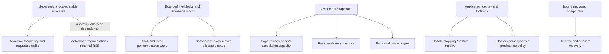

# Root causes, dependencies and remediation order

These are proposals for independent review, **not authorized product changes**.
No replacement architecture is justified by the present evidence.

Solid arrows follow inspected implementation and executed allocation data.
The dotted arrow is a hypothesis: this evaluation did not attribute allocator
metadata, fragmentation or OS retention to an individual Full allocation.
The live-record and snapshot problems share malloc as a mechanism but have
different retained ownership and are not one proven architectural fault.

## Proposal 1 — application history policy before snapshot replacement

**A Parent:** repeated full capture and retained history.
**B Could address:** unnecessary capture frequency, number of retained copies,
redundant unchanged-state exports, serialization cadence.
**C Would not address:** live record allocation, block slack, fresh-handle restore,
crash consistency, business payload persistence, stale handles.
**D Postpone:** snapshot compression/deduplication/incremental-export internals
until cadence/retention policy cannot meet an actual application's needs.
**E Compatibility:** application-only throttling/retention is compatible. Any
future in-memory snapshot redesign must preserve owned immutable views, LS1 and
LKS4SNP1; incompatible bytes need a new wire version.
**F Atomicity/lifetime:** evict only snapshots no longer borrowed by the app;
never trade away copy ownership or failure-atomic capture.
**G Evidence:** 16 x 100k-row snapshots add 42,378,632 requested bytes in this
capture, with 59,154,824 cumulative requested bytes; all are released correctly.
**H Smaller solution sufficient?** Yes for this bounded demonstrator; no measured
customer export budget was exceeded because none was supplied.

Priority **Medium**, confirmed cost, optional application work; internal
representation replacement remains conditional research, not a recommendation.

## Proposal 2 — stable-resident storage experiment only after allocator attribution

**A Parent:** individual resident allocations.
**B Could address:** allocation call frequency, some metadata/locality effects,
possibly some churn allocation overhead.
**C Would not address:** snapshot row/association copying, domain identity,
business-object allocation, OS scheduling, comparator cost, block slack itself.
**D Postpone:** micro-optimizing allocation call sites or retuning B64 while the
main question is whether allocator traffic matters to a real application.
**E Compatibility:** internal pools could preserve source APIs/handle addresses,
but are not automatically compatible semantically; never move resident records.
**F Atomicity/lifetime:** reserve before commit, free every pool on teardown,
retain occurrence expiry and avoid a history-sized stale-pointer registry.
**G Evidence:** 100k append creates 103,124 allocations plus the order allocation;
500k remove/insert pairs produce 500k matched resident allocations/frees while
requested live bytes stay 4,969,584. Instrumented RSS plateaus in these cycles.
No production allocator bottleneck or fragmentation cause was proved.
**H Smaller solution sufficient?** Keep current allocator, measure the intended
deployment allocator first. No pool implementation is justified now.

Priority **Low** for changing Full, confirmed accepted traffic, **unverified**
allocator/RSS causal hypothesis. A later experiment is a medium/large private
refactor with compatibility review, not a reason for a new major version.

## Proposal 3 — consumer recovery guidance and identity discipline

**A Parent:** application-owned identity and multi-call workflows.
**B Could address:** failure recovery after comparator-key edit, retired ID
mapping, domain uniqueness, misunderstanding Group immutability as copied items.
**C Would not address:** per-operation allocation count, general stale-pointer
detection, transactional editing, cross-session object persistence.
**D Postpone:** convenience APIs/registries/adapters until more than this harness
demonstrates repetitive, harmful boilerplate.
**E Compatibility:** a worked recovery example is documentation-only. Persistent
handles or atomic edit operations would be new contracts requiring separate design.
**F Atomicity/lifetime:** removal expires old handles immediately; a failed
reinsertion leaves the application owning a nonresident item. Retry/rebuild or
application undo policy must keep its bookkeeping honest.
**G Evidence:** failures.c explicitly forces this sequence and recovers by retry;
editor.c clears mappings on removal and on successful fresh-order replacement.
An initial evaluator namespace-by-slot design was corrected to per-state domains.
**H Smaller solution sufficient?** Yes. Current contracts already describe these
responsibilities; publish only reviewed, useful examples if later authorized.

Priority **Medium** for application recovery discipline, **Low** for optional
upstream documentation, not a confirmed Full contract defect.

## Proposal 4 — block/index changes

**A Parent:** B64 slack and bounded local work.
**B Could address:** occupancy-dependent slack/local writes.
**C Would not address:** historical memory, LS1 domains, lifetime discipline,
per-resident allocation unless storage is also changed.
**D Postpone:** all capacity sweeps or speculative new indexes.
**E Compatibility:** physical topology is private, but logical traversal,
stable handles and frozen API remain mandatory.
**F Atomicity/lifetime:** splitting/merging must preserve handles and preallocate
fallible storage before irreversible mutation.
**G Evidence:** public append/drag/churn timings and request totals show ordinary
costs; no internal private counters were used by this consumer. The root source
explains 32-byte records/584-byte blocks on this ABI, not a portable API promise.
**H Smaller solution sufficient?** Leave the implementation unchanged.

Priority **None** for an architecture change on current evidence. Do not merge
this concern into snapshot-export work just because both consume memory.

## Ordered recommendation

1. Independently review this consumer, oracles, raw data and provenance first.
2. Keep Full 4.0.0 unchanged; use explicit application recovery, identity,
   serialization and history budgets when integrating it.
3. Obtain genuine editor-user traces and deployment performance budgets.
   This generated consumer narrows an integration gap but does not close it.
4. If export dominates a real workflow, try cadence/retention changes before
   proposing incremental snapshot storage. If allocation dominates, attribute
   allocator behavior before a pool experiment. These are independent branches.
5. Investigate reproducible correctness/portability failures immediately if
   discovered; none was reproduced here. Broaden platform evidence on demand.
6. Leave registries, internal locking, no-heap mode, bindings and package recipes
   optional. Database/CRDT/business-identity ownership remain non-goals.

No urgent Highest/High production action follows from this finite evaluation.
Historical severity is preserved separately in HISTORY.md; it is not today's
action priority. General whole-library latency/formal guarantees remain absent.
